<p align="center">
  
</p>

<h1 align="center">HiByOS</h1>

<p align="center">
  <b>An iOS-style system for the HiBy R3 II: a new home screen, gestures, a Control Centre, widgets and apps, running on top of the stock player.</b>
</p>

<p align="center">
  <a href="https://github.com/Grohle/hibyos/releases/latest"></a>
  <a href="LICENSE"></a>
  
  
  
  
</p>

---

HiByOS is a community firmware for the **HiBy R3 II (2025)** digital audio player. It keeps
HiBy's own music player and audio path exactly as they are and builds a new system around
them:
- an iOS-style home screen with a widgets page;
- system-wide gestures and a multitasking switcher;
- a Control Centre;
- a new Music app, lyrics and cover-art search;
- a file manager and a tag editor;
- an app store;
- a long list of fixes and hidden features unlocked from the stock firmware.

Everything is written for a 57 MB RAM, 320×480 device and measured on the real hardware,
frame by frame.

> **A project directed by [Grohle](https://github.com/Grohle) and executed mostly by AI
> agents.** Grohle set the goals, the design direction and the quality bar ("don't stop
> until it impresses") and tested every build on the device. The reverse engineering, the
> C code, the tools and this documentation were produced by AI coding agents under that
> direction.

<p align="center">
  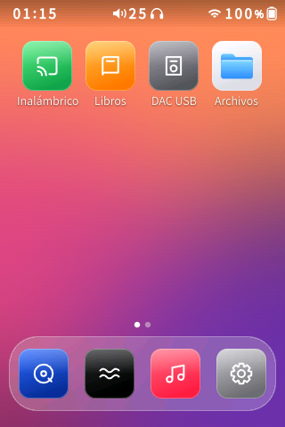
  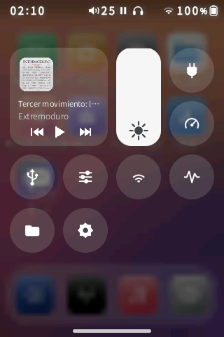
  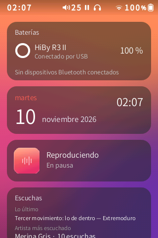
  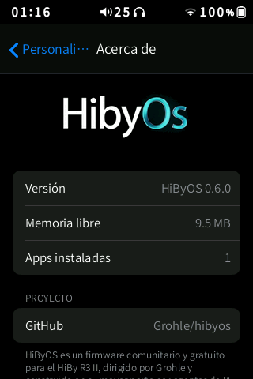
</p>

## Contents

- [Install HiByOS (step by step)](#install-hibyos-step-by-step)
- [Update, uninstall and recovery](#update-uninstall-and-recovery)
- [What it does](#what-it-does)
- [Installing apps](#installing-apps)
- [ADB and developer tools](#adb-and-developer-tools)
- [Building from source](#building-from-source)
- [How it works](#how-it-works)
- [Status and known limitations](#status-and-known-limitations)
- [Licence](#licence)

## Install HiByOS (step by step)

> ⚠️ **At your own risk.** HiByOS has been developed and tested on one HiBy R3 II (2025)
> with the official firmware of 2 March 2026. It never touches the bootloader or HiBy's
> recovery, so you can always reinstall the official firmware from the SD card.

**Why do I have to build the firmware myself?** HiBy's firmware belongs to HiBy, so this
project does not share it, not even modified. You download the official firmware from HiBy
and a script adds HiByOS to *your* copy. It takes one command and about 5 minutes.

### What you need

| | |
|---|---|
| Player | HiBy R3 II (2025), battery above 50 % |
| microSD card | one the player already uses, with at least 100 MB free |
| Computer | any computer with a web browser (Windows, macOS or Linux) |
| Account | a free [GitHub](https://github.com/signup) account, only if you use option A below |

### Step 1. Download the official firmware

1. Download the official **R3 II (2025)** firmware from HiBy's website. The file is called
   `r3ii_2025.upt` (about 47 MB).
2. Keep this file somewhere safe and **never rename or edit it**. It is also what you use
   to go back to the official firmware.

### Step 2. Build the HiByOS firmware

Choose **one** option.

#### Option A: in your browser with GitHub Codespaces (recommended, nothing to install)

1. Open <https://github.com/Grohle/hibyos> and sign in.
2. Click the green **Code** button, open the **Codespaces** tab and click
   **Create codespace on main**. A code editor opens in your browser after a minute or two.
3. Drag `r3ii_2025.upt` from your computer into the **file list on the left** of the
   editor. Drop it on the empty space, not inside a folder. Wait until the upload finishes.
4. Click in the **terminal** at the bottom of the editor. If you don't see one, press
   <kbd>Ctrl</kbd>+<kbd>`</kbd>. Paste these two lines and press <kbd>Enter</kbd>:

   ```bash
   sudo apt-get update && sudo apt-get install -y squashfs-tools
   bash tools/build_hibyos.sh r3ii_2025.upt
   ```

5. Wait for the message **`Done: out/r3ii_2025.upt`**. If it says *"This is not the
   supported official firmware"*, see [Troubleshooting](#troubleshooting).
6. In the file list, open the `out` folder, right-click **`r3ii_2025.upt`** and choose
   **Download**.
7. Your browser saves it as `r3ii_2025.upt`, the **same name as the official file**. To
   avoid mixing them up, rename the download to `hibyos_r3ii_2025.upt` for now; you will
   rename it back in step 4.
8. Delete the codespace when you're done: <https://github.com/codespaces> › **⋯** ›
   **Delete**. Your copy of the firmware is deleted with it.

#### Option B: on Windows with WSL

1. Open **PowerShell** and run `wsl --install -d Ubuntu`. Restart if asked, then open
   **Ubuntu** from the Start menu and create a user.
2. In the Ubuntu window, run (replace `YOUR_NAME` with your Windows user name):

   ```bash
   sudo apt-get update && sudo apt-get install -y git squashfs-tools python3-venv
   git clone https://github.com/Grohle/hibyos && cd hibyos
   bash tools/build_hibyos.sh /mnt/c/Users/YOUR_NAME/Downloads/r3ii_2025.upt
   ```

3. When it says **`Done`**, the HiByOS firmware is at `\\wsl$\Ubuntu\home\<user>\hibyos\out\r3ii_2025.upt`.
   Paste that path in File Explorer's address bar to find it.

#### Option C: on Linux

```bash
sudo apt-get install -y git squashfs-tools python3-venv   # or your distribution's equivalent
git clone https://github.com/Grohle/hibyos && cd hibyos
bash tools/build_hibyos.sh ~/Downloads/r3ii_2025.upt
```

The result is `out/r3ii_2025.upt`. macOS cannot run the build directly: use option A.

### Step 3. Download the HiByOS files for the SD card

1. Open the [latest release](https://github.com/Grohle/hibyos/releases/latest).
2. Under **Assets**, download **`HiByOS-sd-<version>.zip`**.
3. Unzip it. You get a folder called **`HiByOS`**.

### Step 4. Copy the files to the SD card

1. Connect the player to the computer with USB and choose **USB storage** on the player,
   or put the card in a card reader.
2. Optional but recommended: check the card for errors. On Windows, right-click the
   card's drive in File Explorer › **Properties** › **Tools** › **Check**. File-system
   errors can make the player restart while it reads the card.
3. Copy these two items to the **root of the card** (the top level, not inside a folder):
   - the HiByOS firmware from step 2, named exactly **`r3ii_2025.upt`** (rename
     `hibyos_r3ii_2025.upt` back to that name);
   - the **`HiByOS`** folder from step 3.

   The root of the card should then look like this:

   ```
   SD card
   ├── HiByOS/            <- from the release zip
   ├── r3ii_2025.upt      <- the firmware YOU built (not the official one)
   └── (your music and other folders, unchanged)
   ```

4. Eject the card safely, then unplug the USB cable.

### Step 5. Install

1. On the player, open **Settings › Firmware update › Via SD card** and confirm.
2. The player restarts and shows an update progress bar for **about 1 minute**.
   **Do not turn it off or remove the card.**
3. It restarts again and plays the **HiByOS boot animation**. The first boot takes a few
   seconds longer, because HiByOS copies its files from the `HiByOS` folder.
4. The HiByOS home screen appears. Done.

After installing:
- **Keep the `HiByOS` folder on the card.** It is used for updates and for some caches.
- You can delete `r3ii_2025.upt` from the card.
- Recommended: in HiBy's music settings, set the library update to **Manual**. Big
  libraries then don't rescan at every boot.
- HiByOS follows the system language. To pick another one, open **Settings › Language**.

**First steps:**
- Swipe up from the bottom bar to go home.
- Swipe down from the top-left corner for the Control Centre.
- Swipe down from the top-right corner for the player.
- Swipe from the left or right edge to go back.
- Swipe right from the home screen for widgets.

## Update, uninstall and recovery

### Updating to a new version

Each release says whether the firmware changed.
- **Only the SD files changed:**
  1. Replace the `HiByOS` folder on the card with the new one.
  2. Restart the player.

  The new version is installed during start-up, followed by one automatic restart.
- **The firmware changed too:**
  1. Repeat steps 2 to 5 with your official `r3ii_2025.upt`, using the new version of the
     repository (option A: create a new codespace).
  2. Instead of HiBy's update menu, you can also put the new firmware at the root of the
     card and use **Settings › Software update** in HiByOS.

Your settings are kept in both cases: home layout, wallpaper, widgets, gestures, Control
Centre, power mode, DAC filter and installed apps.

### Going back to the official firmware

1. Copy the **official, unmodified** `r3ii_2025.upt` to the root of the card.
2. On the player, open **Settings › Software update** in HiByOS, choose the official
   firmware and confirm. HiBy's own **Firmware update › Via SD card** menu also works.
3. Your music and the card are not touched.

### Troubleshooting

| Problem | What to do |
|---|---|
| The build says *"This is not the supported official firmware"* | Your `.upt` is a different version or was changed. Download it again from HiBy. HiByOS only patches the exact supported version, so that nothing unexpected is written to your player. |
| The screen is frozen | Hold the power button for about 10 seconds until the player turns off, then turn it on again. |
| The player keeps restarting | After three failed starts in a row HiByOS starts in **safe mode**: HiBy's original look, without HiByOS. To leave safe mode, use the `NORMAL` command below. |
| HiByOS does not start at all | Use a command file (below). As a last resort, use `REINSTALL` with the official firmware at the root of the card. |
| Something else went wrong | Look in the card's `hibymod/logs/` folder and in `HiByOS/install.log`, and attach them to an [issue](https://github.com/Grohle/hibyos/issues). |

**Command files.** For problems that happen while the player starts:
1. Put the card in a computer.
2. Create a folder called `hibymod` at the root of the card, if it does not exist.
3. Inside it, create an **empty file** with one of the names below. Windows may add `.txt`;
   that's fine.
4. Put the card back in the player and turn it on.

The player applies the command once and renames the file to `<name>.done`.

| File name | Effect |
|---|---|
| `SAFE` | start in safe mode (HiBy's original look) |
| `NORMAL` | leave safe mode |
| `NO_SHELL` | start without the HiByOS interface; `SHELL_ON` turns it back on |
| `REINSTALL` | reinstall the `r3ii_2025.upt` that is at the root of the card (put the official one there to go back to stock) |
| `ADB_WIFI` | turn on ADB over Wi-Fi |

## What it does

### A new system on top of the stock player

- **Boot animation.** The HiByOS logo animation loops on a black background while the
  system starts, and hands over to the home screen without a visible cut.
- **Home screen.**
  - iOS-style pages and dock;
  - wallpapers from the SD card (9 included);
  - 3 to 5 columns and three icon sizes;
  - an edit mode with the jiggle animation;
  - apps fill the grid from the top left, with no empty pages.
- **Widgets page** (swipe right from home):
  - small and medium iOS-style widgets: battery rings, now playing, listening stats,
    recently added, library and storage;
  - edit them like apps: remove, add from a gallery, reorder; or turn the page off.
- **Gestures, all configurable** (Settings › Gestures, each with an animated demo). The
  defaults:
  - **left or right edge:** back, with a bubble that follows your finger;
  - **swipe up from the bottom bar:** home; **swipe up and hold:** the multitasking
    switcher with the current app and the player;
  - **down from the top-left:** Control Centre; **down from the top-right:** the player;
  - **left/right between the player and the Control Centre:** switch between them;
  - **up in either of them:** back to home.
- **Control Centre (iOS 26 style).** It opens following your finger over a blurred copy of
  the screen. It has:
  - **Now Playing** with the real track, its cover and ⏮ ⏯ ⏭;
  - a brightness slider that behaves like iOS;
  - round controls: **USB only (don't charge the battery)**, **power mode**, **USB DAC**,
    the HiBy panel, Wireless, **DAC filter**, Files and Settings.

  You choose which controls appear (Settings › Control Centre).
- **Music app.** An Apple Music-style library:
  - albums in a cover grid; artists, songs, genres and recently added;
  - album pages, search, and a mini-player;
  - mixes and "song radio" generated from your listening.
- **Lyrics and cover art search** from public sources (LRCLIB, iTunes, Cover Art Archive):
  - apply to the current song only or to the **whole album**;
  - covers are embedded into FLAC, MP3 and M4A files.
- **Status bar.** Redrawn on every screen, HiBy's included:
  - the time;
  - icons at the same height;
  - a rounded battery;
  - no icon when Wi-Fi or Bluetooth are off.
- **Volume HUD:** an iOS volume pill that follows the real level.
- **Files.** A Finder-like file manager for the SD card and internal storage:
  - multi-select, rename, move, delete with progress, new folders;
  - a text editor and an image viewer.
- **Tag editor.** Edit title, artist, album, album artist, genre, year, track and disc:
  - autocomplete from your library;
  - edit many files at once.
- **iOS keyboard:**
  - adjustable height (drag its top edge) and an always-visible close key;
  - long-press accents and cursor movement on the space bar;
  - its settings are reachable from the keyboard itself.
- **App Store.** Install `.hpk` apps from online repositories (this project's by default,
  others can be added) or from the SD card. Apps can be installed on the card or on the
  player, backed up and uninstalled.
- **13 languages:** English, Spanish, French, German, Italian, Polish, Russian, Ukrainian,
  Japanese, Korean, Thai, and Simplified and Traditional Chinese.

### Hidden firmware features, unlocked (low risk)

| Feature | What changed |
|---|---|
| **8 DAC digital filters** | The ES9219 driver forced every filter except one to "fast". HiByOS patches the kernel module so all 8 shapes work: fast and slow, linear and minimum phase, apodizing, hybrid, brickwall. Choose one in Settings › Audio & system or from the Control Centre |
| Car mode | Plays when USB power appears and turns off when it goes. Now visible in HiBy's System settings |
| Standby, double-tap to wake, no charging in DAC mode | Present in the firmware but hidden; now visible in System settings |
| EU volume warning | Can be turned off, with a hearing-safety confirmation. It removes the prompt only and adds no power |
| Library and cover cache on the SD card | Faster with big libraries and less wear on the internal memory |
| USB only, no charging | The device runs from USB without charging the battery, for long sessions plugged in |
| Power modes | **Low power**: 30 fps animations and brightness capped at 40 %. **Normal** and **Performance**: animations at the panel's full rate |
| Real-time audio | The player's audio thread runs with real-time priority, so the interface never interrupts playback |

**No overclock, on purpose.** The CPU already runs at 1104 MHz, 10 % above the X1600's
rated 1.0 GHz. The interface is limited by the LCD panel and by memory, not by the CPU.
Raising the clock brings a high risk of instability for no visible gain. See
[the research](docs/research_overclock_power.md).

### Stability and speed fixes

- The music database partition is no longer mounted with `-o sync`, which made library
  scans painfully slow.
- **Crash supervisor.** When the player crashes, a report goes to the SD card instead of a
  silent reboot.
- **Safe mode** after three failed starts, and **command files** on the SD card for
  recovery.
- Screen updates are synchronised with the panel scan, so there is no tearing.
- A faster `wpa_cli` replaces the stock one, which the player runs every 3 s.
- Memory tuning, and the player and its theme are served from fast storage.

## Screenshots

<p align="center">
  
  
  
  
  
</p>
<p align="center">
  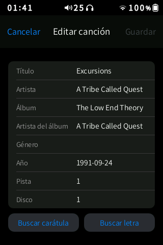
  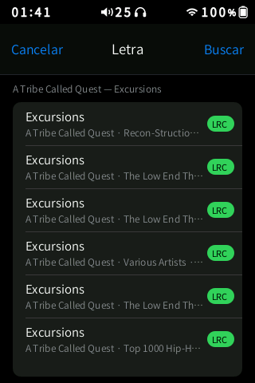
  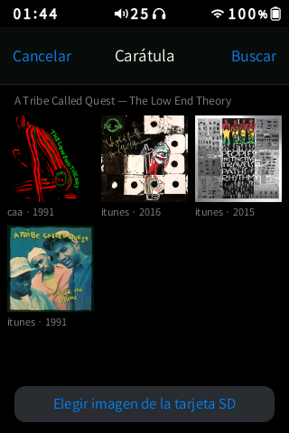
  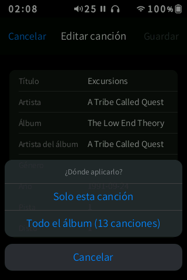
  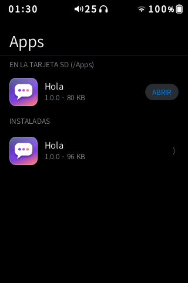
</p>
<p align="center">
  
  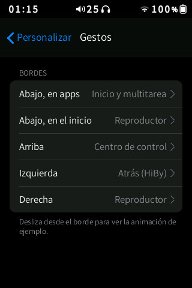
  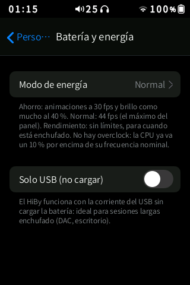
  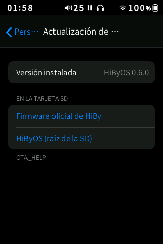
  
</p>

## Installing apps

HiByOS apps are `.hpk` packages: a tar archive with a `manifest.ini`, an `icon.png` and a
static MIPS executable.

- **From the store:** open **Apps** on the home screen, find an app and tap **GET**.
  Choose whether to install it on the SD card or on the player.
- **From a file:** copy the `.hpk` file to the **`Apps/`** folder at the root of the SD
  card, then open **Apps**: it appears under "On the SD card".
- **Managing apps:** in **Apps**, tap an installed app to open it, back it up, uninstall it
  or erase its data.
- **Closing an app:** swipe up from the bottom bar.

If an app needs the memory that the player uses, the music is paused first and the app is
told so.

**Writing an app:** read the format and the API in
[docs/APP_FORMAT.md](docs/APP_FORMAT.md):
- the C header is [src/sdk/hm_app.h](src/sdk/hm_app.h);
- the packer is [tools/hpk.py](tools/hpk.py);
- [apps/hola](apps/hola) is a complete example.

The store and repository format are described in [docs/STORE.md](docs/STORE.md).

## ADB and developer tools

- **ADB over USB or Wi-Fi.** Choose it in Settings › Developer.
  - **USB:** the computer sees the SD card and an "ADB Interface" at the same time. Windows
    needs no driver.
  - **Wi-Fi:** run `adb connect <address>:5555` from a computer on the same network. The
    address is shown on the same settings page.
- **Scripts for working over ADB** live in [tools/](tools):

  | Script | What it does |
  |---|---|
  | `hiby.py` | tap, swipe, screenshot, home and sheets |
  | `hibyshot.py` | screenshot |
  | `readme_shots.py` | scripted screenshot tours |
  | `recsheet.py` | turns recordings into frame-by-frame contact sheets with frame timings |
  | `raw2png.py` | converts a raw RGB565 frame to PNG |
  | `device/*.sh` | diagnostics and benchmarks run on the device |

  On the device, `hibyctl` (in `/usr/bin`) injects touches and keys, takes screenshots,
  records frames (`hibyctl rec`) and measures fps.
- **Test VM** ([apps/harness_vm](apps/harness_vm)): a QEMU `mipsel` machine with a 320×480
  framebuffer and the same input devices and memory as the HiBy. It boots in about 4 s and
  is used to try apps and stress memory without touching the device. See
  [docs/research_apps_vm.md](docs/research_apps_vm.md).

## Building from source

Everything is built on Linux (WSL on Windows works) with **zig** as the cross-compiler.
There is no vendor SDK.

- Static programs (`hibyshell`, `hibyboot`, `hibywall`, `hibymix`, `hibytag`, `hibynet`,
  apps) target `mipsel-linux-musleabihf -mcpu=mips32r2`. They must be **hard-float**:
  soft-float ran 14× slower.
- The display and input shim `hibymod_disp.so` targets glibc 2.22, so that the stock
  player can load it.

```bash
# third-party headers and sources (stb, SQLite, libjpeg) into ~/hiby/third
bash tools/wsl/getstb.sh; bash tools/wsl/getsqlite.sh; bash tools/wsl/getjpeg.sh
python3 -m venv ~/hiby/venv && ~/hiby/venv/bin/pip install ziglang pycdlib pillow qrcode

bash tools/wsl/zbuild_shell.sh       # bin/hibyshell (the interface)
bash tools/wsl/zbuild_boot.sh        # bin/hibyboot (boot animation)
bash tools/wsl/zbuild_so.sh src/hibymod_disp.c bin/hibymod_disp.so
bash tools/wsl/zbuild_mix.sh; bash tools/wsl/zbuild_tag.sh; bash tools/wsl/zbuild_wall.sh; bash tools/wsl/zbuild_net.sh

python3 tools/bootanim.py theme/bootanim/source.mp4 theme/bootanim   # animation (HBA1)
python3 theme/topbar.py; python3 theme/hibyos_brand.py; python3 tools/shell_assets.py
bash tools/build_hibyos.sh /path/to/official/r3ii_2025.upt          # firmware -> out/r3ii_2025.upt
python3 tools/make_payload.py        # SD folder HiByOS/ -> out/sd/
```

`tools/build.py` does the following:
- unpacks the official `.upt`, an ISO9660 image with MD5-chained chunks;
- applies [overlay/](overlay) plus a few text and binary patches, including the DAC
  filter patch, which is checked against the original module's MD5;
- rebuilds the squashfs, verifies that only the expected files changed, and checks that
  the image fits the partition.

How the SD installer works is described in [docs/INSTALLER.md](docs/INSTALLER.md).

## How it works

**The HiBy player stays in charge.** `hiby_player` is HiBy's closed program that draws the
stock interface and plays the audio. Around it:

- **The display shim** `hibymod_disp.so` is loaded into the player with `LD_PRELOAD`. It
  intercepts the player's page flips (`FBIOPAN_DISPLAY`). That lets HiByOS:
  - hold the player's frames, capture them, or replace them with its own;
  - blend an overlay sprite into them;
  - swap the stock home screen for the HiByOS one before it is ever shown.

  It also clones the touch screen with `uinput`, so the player only sees the touches
  HiByOS passes on, and it gives HiByOS a safe way to start playlists in the player
  ([docs/research_play_list.md](docs/research_play_list.md)).
- **`hibyshell`** draws everything new in software, into a 320×480 RGB565 buffer:
  - a single C program, statically linked;
  - text uses stb_truetype with the device's own font, plus fallback fonts for Korean
    and Thai;
  - there is no GPU, so the "glass" is precomputed or blurred once, never per frame;
  - it never draws while idle, and animations run at the panel's rate;
  - it is measured with frame-by-frame recordings
    ([docs/UI_GUIDE_FOR_AGENTS.md](docs/UI_GUIDE_FOR_AGENTS.md) is the quality bar every
    change must pass).
- **Theme files.** HiBy's interface is defined by JSON `.view` files and PNGs. HiByOS
  restyles them and bind-mounts its copies at boot, so the system partition stays
  untouched. That is how the status bar, the About page and the boot screen are
  restyled everywhere.

### The research behind it

| Document | Topic |
|---|---|
| [research_hidden_firmware.md](docs/research_hidden_firmware.md) | Hidden features, output power, DAC filters |
| [research_overclock_power.md](docs/research_overclock_power.md) | Clocks, overclock, power saving, charging |
| [research_60fps.md](docs/research_60fps.md) | Panel refresh rate, tearing, 60 fps |
| [research_playback.md](docs/research_playback.md) | Controlling the stock player |
| [research_play_list.md](docs/research_play_list.md) | Starting playlists inside the stock player |
| [research_youtube_music.md](docs/research_youtube_music.md) | YouTube Music on the device |
| [research_mpd_player.md](docs/research_mpd_player.md) | Replacing the player (MPD): not recommended |
| [research_apps_vm.md](docs/research_apps_vm.md) | Test VM, browser, Telegram |
| [LYRICS_AND_COVERS.md](docs/LYRICS_AND_COVERS.md) | Lyrics and cover-art search |
| [APP_FORMAT.md](docs/APP_FORMAT.md) | The `.hpk` app format and SDK |

## Status and known limitations

- **Tested on one device.** Reports from other R3 II (2025) units are welcome.
- **Partly restyled.** Some of HiBy's own screens (system settings, wireless, books,
  streaming) keep the stock look apart from the status bar; replacing them is in progress.
- **The browser app** is not available yet: it needs more memory than the player leaves
  free, and stays blocked until it passes the off-device tests.
- **YouTube Music is not included.** The research is in `docs/`.
- **USB only (no charging).** The battery charger driver re-enables charging a few seconds
  after every plug-in, so HiByOS reasserts the setting every 30 s while USB is connected.

## Licence

HiByOS is **free for any non-commercial use**:
- use, modify and share it, keeping the licence;
- **selling it or distributing it for money needs a commercial licence**;
- for that or any other special licence, open an issue to contact
  [Grohle](https://github.com/Grohle).

See [LICENSE](LICENSE). HiByOS is an independent project, not affiliated with HiBy. The
official HiBy firmware is not part of it and is never redistributed.

## Acknowledgments

- **HiBy**, for an excellent little player whose firmware is open enough (Linux, JSON
  views, a stock recovery) to be extended safely.
- **[stb](https://github.com/nothings/stb)** by Sean Barrett, **SQLite**, **Mbed TLS** and
  the **Independent JPEG Group**, used inside HiByOS.
- **[LRCLIB](https://lrclib.net)**, the **iTunes Search API** and the
  **[Cover Art Archive](https://coverartarchive.org)** for lyrics and covers.
- **[Zig](https://ziglang.org)**, whose `zig cc` made cross-compiling for this MIPS device
  painless.
