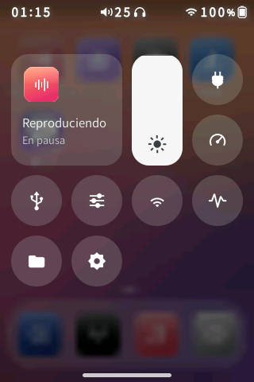
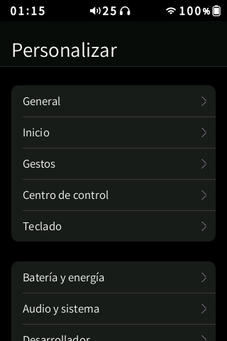
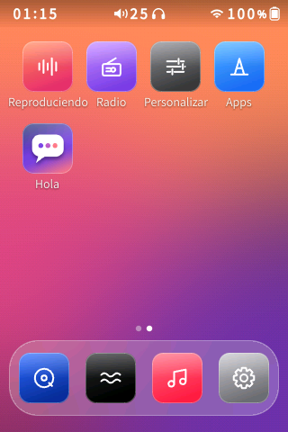
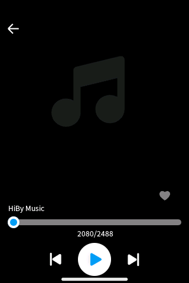
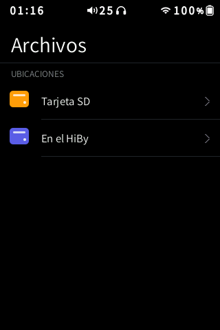
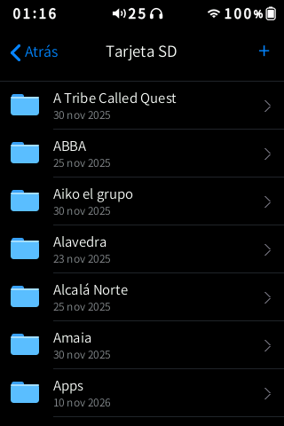
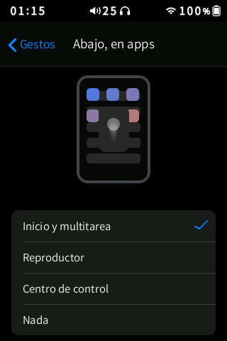
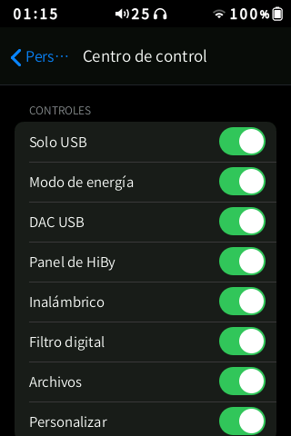
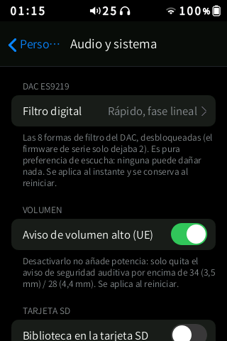

<p align="center">
  
</p>

<h1 align="center">HiByOS</h1>

<p align="center">
  <b>An iOS-style system for the HiBy R3 II: a new home screen, gestures, a Control Centre and apps, running on top of the stock player.</b>
</p>

<p align="center">
  <a href="https://github.com/Grohle/hibyos/releases/latest"></a>
  <a href="LICENSE"></a>
  
  
  
  
</p>

---

HiByOS is a community firmware for the **HiBy R3 II (2025)** digital audio player. It keeps
HiBy's own music player and audio path exactly as they are and builds a new system around
them: an iPod-meets-iOS home screen, system-wide gestures, a multitasking switcher, a
Control Centre, a file manager, a tag editor, an app store with its own package format, and
a long list of fixes and hidden features unlocked from the stock firmware. Everything is
written for a 57 MB RAM, 320×480 device and measured on the real hardware, frame by frame.

> **A project directed by [Grohle](https://github.com/Grohle) and executed mostly by AI
> agents.** Grohle set the goals, the design direction and the quality bar ("don't stop
> until it impresses") and tested every build on the device; the reverse engineering, the
> C code, the tools and this documentation were produced by AI coding agents under that
> direction.

<p align="center">
  
  
  
  
</p>

## Contents

- [What it does](#what-it-does)
- [Screenshots](#screenshots)
- [Installation](#installation)
- [Installing apps](#installing-apps)
- [ADB and developer tools](#adb-and-developer-tools)
- [Building from source](#building-from-source)
- [How it works](#how-it-works)
- [Status and known limitations](#status-and-known-limitations)
- [Licence](#licence)

## What it does

### A new system on top of the stock player

- **Boot animation.** The HiByOS logo animation plays in a loop while the system starts,
  on a pure black background, and hands over to the player without a visible cut
  (`hibyboot`: 1.2 MB, about 3 % of the CPU).
- **Home screen.** iOS-style pages and dock, a choice of wallpapers (from `/Pictures` on the
  SD card or anywhere on it; 9 are included, black among them), 3–5 columns, three icon
  sizes, an edit mode with a jiggle animation, and dragging apps between pages by holding
  them at the edge. Returning home is instant: the stock home screen is replaced by an
  exact image of ours before it is ever drawn.
- **Gestures, all configurable** (Settings › Gestures, each with an animated demo):
  - from the **bottom bar**: go home, flying back to the app's icon; swipe up and hold for
    the **multitasking switcher** with the cards "where you were" and "Now Playing";
  - from the **top**: the Control Centre;
  - from the **left edge**: back;
  - from the **right edge**: the player;
  - each edge can open the player, the Control Centre, go home, go back, or do nothing.
- **Now Playing** opens as a sheet that follows your finger and closes by swiping down.
- **Control Centre (iOS 26 style).** It opens following your finger over a blurred copy of
  the screen. It has:
  - a *Now Playing* module and a vertical brightness slider;
  - round controls: **USB only (don't charge the battery)**, **power mode**, **USB DAC**,
    the stock HiBy panel, Wireless, **DAC filter**, Files and Settings.

  You choose which controls appear (Settings › Control Centre).
- **New status bar**, the same on every screen, HiBy's included:
  - the time on the left, in a heavier weight;
  - tabular digits;
  - every icon redrawn at the same height;
  - a rounded battery;
  - no icon when Wi-Fi or Bluetooth are off, as on iOS.
- **Volume HUD.** An iOS volume pill that tracks the real level. The level is read from the
  status bar with an OCR of the digits, so it is always exact.
- **Files.** A Finder-like file manager for the SD card and internal storage. It has:
  - push and pop animations, multi-select by long press, rename, move, delete with
    progress, and new folders;
  - a text editor and an image viewer.
- **Tag editor.** An *Edit* button next to the file's properties and *Delete*:
  - edit title, artist, album, album artist, genre, year, track and disc;
  - get autocomplete from your library as you type;
  - edit many files at once with a progress card;
  - the music database is updated afterwards.
- **iOS keyboard** with three heights, an optional number row, and Spanish (with ñ),
  English or French (AZERTY) layouts.
- **Song radio and mixes.** `hibymix` builds recommended playlists from a song or an
  artist, plus *Mix of the day*, *Discover*, *Favourites*, *New* and *Decades*, as `.m3u`
  files.
- **App Store.** Apps come as `.hpk` packages, installed from the SD card (see below).
- **Three languages** across everything HiByOS adds: English, Spanish and French.

### Hidden firmware features, unlocked (low risk)

| Feature | What changed |
|---|---|
| **8 DAC digital filters** | The ES9219 driver forced every filter except one to "fast". HiByOS patches the kernel module so all 8 shapes work: fast and slow, linear and minimum phase, apodizing, hybrid, brickwall. Choose one in Settings › Audio & system or from the Control Centre |
| Car mode | Plays when USB power appears and turns off when it goes. Now visible in HiBy's System settings |
| Standby, double-tap to wake, no charging in DAC mode | Present in the firmware but hidden; now visible in System settings |
| EU volume warning | Can be turned off, with a hearing-safety confirmation. It removes the prompt only and adds no power |
| Library and cover cache on the SD card | Faster with big libraries and less wear on the internal memory |
| USB only, no charging | The device runs from USB without charging the battery, for long sessions plugged in |
| Power modes | **Low power**: 30 fps animations and brightness capped at 40 %. **Normal**: 44 fps, the panel's maximum. **Performance**: no limits |

**No overclock, on purpose.** The CPU already runs at 1104 MHz, 10 % above the X1600's
rated 1.0 GHz. The interface is limited by the LCD panel (≈44 Hz) and by memory, not by
the CPU. Raising the PLL brings a high risk of instability for no visible gain. See
[the research](docs/investigacion_overclock_energia.md).

### Stability and speed fixes

- The music database partition is no longer mounted with `-o sync`, which made library
  scans painfully slow.
- **Crash supervisor.** When the player crashes, a report goes to the SD card instead of a
  silent reboot.
- **Safe mode.** Three failed boots in a row start the stock theme.
- **SD-card command files** for recovery.
- A faster `wpa_cli` replaces the stock one, which the player runs every 3 s.
- Memory tuning, and the player and its theme are served from fast storage.

## Screenshots

<p align="center">
  
  
  
  
  
</p>
<p align="center">
  
  
  
  
  
</p>
<p align="center">
  
  
  
</p>

## Installation

> ⚠️ Installing custom firmware is at your own risk. HiByOS has been developed and tested on
> one HiBy R3 II (2025), firmware of 2 March 2026. It does not touch the bootloader or the
> official recovery, so the stock firmware can always be reinstalled from the SD card.

**You need:**
- a HiBy R3 II (2025);
- a microSD card formatted by the player (FAT32 or exFAT);
- the latest [release](https://github.com/Grohle/hibyos/releases/latest).

1. **Keep a copy of the official firmware**, `r3ii_2025.upt` from HiBy's website, in case
   you want to go back.
2. Check the card on a computer (`chkdsk X: /f` on Windows): file-system errors on the SD
   can make the stock kernel reboot.
3. Copy two things to the **root** of the SD card:
   - `r3ii_2025.upt`, the HiByOS firmware;
   - the `HiByOS/` folder, which holds the system files the firmware installs on first boot.
4. On the player: **Settings › Firmware update › Via SD card**. The official recovery
   writes the new system and restarts (about 1 minute).
5. On the first boot HiByOS copies its files from `HiByOS/` into the internal memory
   (a few seconds) and starts. The installer keeps a log in `HiByOS/install.log`.
6. Recommended: in HiBy's music settings, set the **library update to Manual**.

**Updating:** repeat steps 3–4 with the new release. Your settings (home layout,
wallpaper, gestures, Control Centre, power mode, filter, installed apps) are kept.

**Going back to stock:** copy the official `r3ii_2025.upt` to the root of the SD card and
update from the SD card as above. If the interface does not respond, create an empty file
named `REINSTALAR` in the card's `hibymod/` folder and power on: the official recovery
reinstalls whatever `.upt` is at the root of the card.

**If something goes wrong:**
- after three failed boots, the device starts in **safe mode** (stock look);
- empty files in the card's `hibymod/` folder act as commands at power-on:
  - `SAFE`: start in safe mode;
  - `SIN_SHELL`: start without HiByOS's interface;
  - `REINSTALAR`: reinstall the firmware at the root of the card;
- crash reports are saved in `hibymod/logs/` on the card.

## Installing apps

HiByOS apps are `.hpk` packages: a tar archive with a `manifest.ini`, an `icon.png` and a
static MIPS executable.

1. Copy the `.hpk` file to the **`Apps/`** folder at the root of the SD card.
2. Open **Apps** on the home screen. Each package shows **GET**, **UPDATE** or **OPEN**,
   with a detail page to install or uninstall it.
3. Installed apps appear on the home screen like any other.
4. **Swipe up from the bottom bar** to close an app.

Apps run full-screen with touch input. If an app needs the memory the player uses, the
music is paused first, and the app is told so.

**Writing an app:** read the format and the API in
[docs/FORMATO_APPS.md](docs/FORMATO_APPS.md):
- the C header is [src/sdk/hm_app.h](src/sdk/hm_app.h);
- the packer is [tools/hpk.py](tools/hpk.py);
- [apps/hola](apps/hola) is a complete example.

## ADB and developer tools

- **ADB over USB or Wi-Fi.** Choose it in Settings › Developer; the help text is in three
  languages.
  - **USB:** the computer sees the SD card and an "ADB Interface" at the same time. Windows
    needs no driver. The first time, run `adb shell` within 90 s to confirm; otherwise it
    falls back to Wi-Fi.
  - **Wi-Fi:** run `adb connect <address>` on the same network. The address is shown on the
    same settings page.
- **Scripts for working over ADB** live in [tools/](tools):

  | Script | What it does |
  |---|---|
  | `hiby.py` | tap, swipe, screenshot, home and sheets |
  | `hibyshot.py` | screenshot |
  | `readme_shots.py` | scripted screenshot tours |
  | `recsheet.py` | turns recordings into frame-by-frame contact sheets with frame timings |
  | `raw2png.py` | converts a raw RGB565 frame to PNG |
  | `device/*.sh` | diagnostics and benchmarks run on the device |

  On the device, `hibyctl` (in `/usr/bin`) injects touches and keys, takes screenshots,
  records frames (`hibyctl rec`) and measures fps.
- **Test VM** ([apps/harness_vm](apps/harness_vm)): a QEMU `mipsel` machine with a 320×480
  framebuffer and the same input devices and memory as the HiBy. It boots in about 4 s and
  is used to try apps and stress memory without touching the device. See
  [docs/investigacion_apps_vm.md](docs/investigacion_apps_vm.md).

## Building from source

Everything is built on Linux (WSL on Windows works) with **zig** as the cross-compiler.
There is no vendor SDK.

- Static programs (`hibyshell`, `hibyboot`, `hibywall`, `hibymix`, `hibytag`, apps) target
  `mipsel-linux-musleabihf -mcpu=mips32r2`. They must be **hard-float**: soft-float ran
  14× slower.
- The display and input shim `hibymod_disp.so` targets glibc 2.22, so that the stock
  player can load it.

```bash
# third-party headers and sources (stb, SQLite, libjpeg) into ~/hiby/third
bash tools/wsl/getstb.sh; bash tools/wsl/getsqlite.sh; bash tools/wsl/getjpeg.sh
python3 -m venv ~/hiby/venv && ~/hiby/venv/bin/pip install ziglang pycdlib pillow qrcode

bash tools/wsl/zbuild_shell.sh       # bin/hibyshell (the interface)
bash tools/wsl/zbuild_boot.sh        # bin/hibyboot (boot animation)
bash tools/wsl/zbuild_so.sh src/hibymod_disp.c bin/hibymod_disp.so
bash tools/wsl/zbuild_mix.sh; bash tools/wsl/zbuild_tag.sh; bash tools/wsl/zbuild_wall.sh

python3 tools/bootanim.py theme/bootanim/source.mp4 theme/bootanim   # animation (HBA1)
python3 theme/topbar.py; python3 theme/hibyos_brand.py; python3 tools/shell_assets.py
bash tools/wsl/b.sh                  # firmware: official .upt + overlay -> out/r3ii_2025.upt
python3 tools/make_payload.py        # SD folder HiByOS/ -> out/sd/
```

`tools/build.py` does the following:
- unpacks the official `.upt`, an ISO9660 image with MD5-chained chunks;
- applies [overlay/](overlay) plus a few text and binary patches, including the DAC
  filter patch, which is checked against the original module's MD5;
- rebuilds the squashfs, verifies that only the expected files changed, and checks that
  the image fits the partition.

## How it works

**The HiBy player stays in charge.** `hiby_player` is HiBy's closed program that draws the
stock interface and plays the audio. Around it:

- **The display shim** `hibymod_disp.so` is loaded into the player with `LD_PRELOAD`. It
  intercepts the player's page flips (`FBIOPAN_DISPLAY`). That lets HiByOS:
  - hold the player's frames, capture them, or replace them with its own;
  - blend an overlay sprite into them;
  - swap the stock home screen for the HiByOS one before it is ever shown.

  It also clones the touch screen with `uinput`, so the player only sees the touches
  HiByOS passes on.
- **`hibyshell`** draws everything new in software, into a 320×480 RGB565 buffer:
  - a single C program, about 500 KB, statically linked;
  - text uses stb_truetype with the device's own font;
  - there is no GPU, so the "glass" is precomputed or blurred once, never per frame;
  - it never draws while idle, and animations run at the panel's 44 Hz;
  - it is measured with frame-by-frame recordings
    ([docs/GUIA_UI_AGENTES.md](docs/GUIA_UI_AGENTES.md) is the quality bar every change
    must pass).
- **Theme files.** HiBy's interface is defined by JSON `.view` files and PNGs. HiByOS
  restyles them and bind-mounts its copies at boot, so the system partition stays
  untouched. That is how the status bar, the About page and the boot screen are
  restyled everywhere.

### The research behind it (in Spanish)

| Document | Topic |
|---|---|
| [investigacion_firmware_oculto.md](docs/investigacion_firmware_oculto.md) | Hidden features, output power, DAC filters |
| [investigacion_overclock_energia.md](docs/investigacion_overclock_energia.md) | Clocks, overclock, power saving, charging |
| [investigacion_youtube_music.md](docs/investigacion_youtube_music.md) | YouTube Music on the device |
| [investigacion_reproductor_mpd.md](docs/investigacion_reproductor_mpd.md) | Replacing the player (MPD): not recommended |
| [investigacion_apps_vm.md](docs/investigacion_apps_vm.md) | Test VM, browser, Telegram |
| [FORMATO_APPS.md](docs/FORMATO_APPS.md) | The `.hpk` app format and SDK |

## Status and known limitations

- **Tested on one device.** Reports from other R3 II (2025) units are welcome.
- **Partly restyled.** Most of HiBy's own menus (music library, system settings) keep the
  stock look apart from the status bar; re-theming them is the next big task.
- **Mixes and radio.** They are generated as playlists, but the stock interface does not
  list them. A HiByOS player view for them is in progress.
- **YouTube Music is not included.** The research is in `docs/`.
- **USB only (no charging).** The battery charger driver re-enables charging a few seconds
  after every plug-in, so HiByOS reasserts the setting every 30 s while USB is connected.

## Licence

HiByOS is **free for any non-commercial use**:
- use, modify and share it, keeping the licence;
- **selling it or distributing it for money needs a commercial licence**;
- for that or any other special licence, open an issue to contact
  [Grohle](https://github.com/Grohle).

See [LICENSE](LICENSE). HiByOS is an independent project, not affiliated with HiBy. The
official HiBy firmware is not part of it.

## Acknowledgments

- **HiBy**, for an excellent little player whose firmware is open enough (Linux, JSON
  views, a stock recovery) to be extended safely.
- **[stb](https://github.com/nothings/stb)** by Sean Barrett, **SQLite** and the
  **Independent JPEG Group**, used inside HiByOS.
- **[Zig](https://ziglang.org)**, whose `zig cc` made cross-compiling for this MIPS device
  painless.
