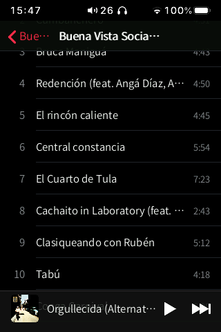
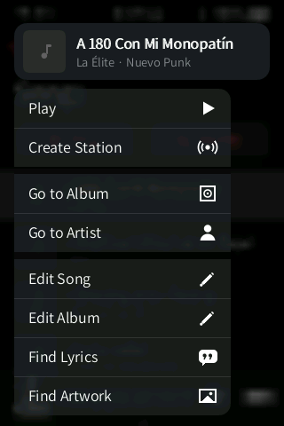
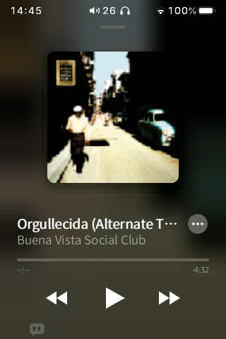
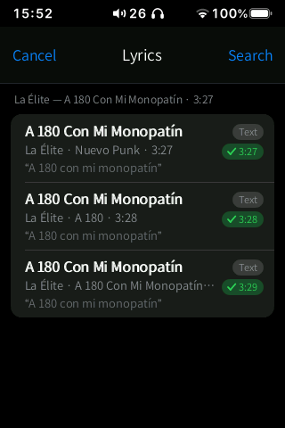
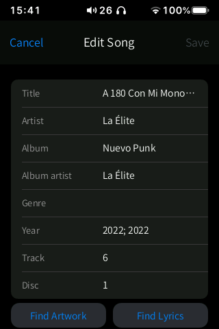
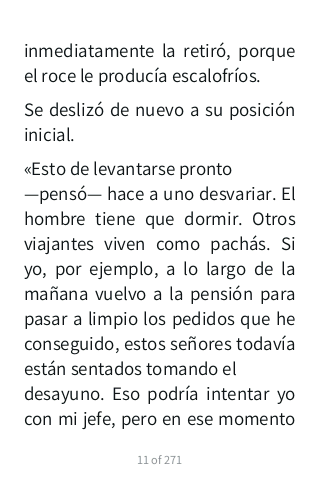
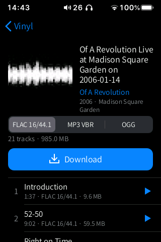
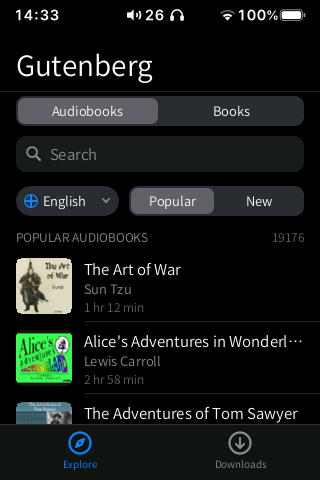

<p align="center">
  
</p>

<h1 align="center">ByOS</h1>

<p align="center">
  <b>An iOS-style system for the HiBy R3 II: a new home screen, gestures, a Control Center, widgets and apps, running on top of the stock player.</b>
</p>

<p align="center">
  <a href="https://github.com/Grohle/hibyos/releases/latest"></a>
  <a href="LICENSE"></a>
  
  
  
  
</p>

<p align="center">
  <a href="https://buymeacoffee.com/grohle"></a>
</p>

---

ByOS (formerly HiByOS) is a community firmware for the **HiBy R3 II (2025)** digital audio player. It keeps
HiBy's own music player and audio path exactly as they are and builds a new system around
them:
- an iOS-style home screen with a dock of four apps and a widgets page;
- system-wide gestures and a multitasking switcher;
- a Control Center with Airplane Mode, headphone noise control and Bluetooth;
- a new Music app with synced lyrics, cover-art search and a tag editor;
- Books (e-books and audiobooks), Vinyl (free music), Gutenberg, Radio, Headphones and Files;
- an app store: the included apps come preinstalled and can be updated or uninstalled;
- over-the-air updates from this project's releases;
- a long list of fixes and hidden features unlocked from the stock firmware.

Everything is written for a 57 MB RAM, 320×480 device and tested on the real player, frame
by frame, so that it runs faster and smoother than the stock interface. All the screenshots
on these pages were taken on a real HiBy R3 II (2025).

> **A project directed by [Grohle](https://github.com/Grohle) and executed mostly by AI
> agents.** Grohle set the goals, the design direction and the quality bar ("don't stop
> until it impresses") and tested every build on the device. The reverse engineering, the
> C code, the tools and this documentation were produced by AI coding agents under that
> direction.

<p align="center">
  
  
  
  
</p>

## Contents

- [Apps](#apps)
- [Install ByOS (step by step)](#install-byos-step-by-step)
- [Update, uninstall and recovery](#update-uninstall-and-recovery)
- [What it does](#what-it-does)
- [Installing apps](#installing-apps)
- [ADB and developer tools](#adb-and-developer-tools)
- [Building from source](#building-from-source)
- [How it works](#how-it-works)
- [Known issues](#known-issues)
- [Support the project](#support-the-project)
- [Licence](#licence)

## Apps

Every app has its own page with screenshots, a step-by-step guide, its settings and its
known limitations: see the **[app index](apps/README.md)**.

| | App | What it does | Status |
|---|---|---|---|
|  | [Music](apps/music/README.md) | Apple Music-style library, mixes, Now Playing with synced lyrics, tag editor | Beta |
|  | [Files](apps/files/README.md) | File manager for the SD card and internal storage, image viewer, text editor | Stable |
|  | [Books](apps/books/README.md) | EPUB / TXT reader, audiobooks, free catalogs you can add (OPDS) | Beta |
|  | [Gutenberg](apps/gutenberg/README.md) | Project Gutenberg books and LibriVox audiobooks, to download and read | Beta |
|  | [Vinyl](apps/freemusic/README.md) | Free and Creative Commons music (Internet Archive, Jamendo, your own sources), with format and quality | Beta |
|  | Radio ([docs/RADIO.md](docs/RADIO.md)) | Internet radio: the Radio Browser directory, a built-in list of European public radio (HLS included), your own sources and stations | Beta |
|  | [Settings](apps/settings/README.md) | Player and system settings, USB DAC, home screen, gestures, Control Center, keyboard, updates (the old Customize app is now part of it) | Beta |
|  | [Wireless](apps/wireless/README.md) | Wi-Fi and Bluetooth | Beta |
|  | [Apps](apps/store/README.md) | App store: repositories, `.hpk` files, SD card installs, backups | Beta |
|  | [Headphones](apps/headphones/README.md) | AirPods, Galaxy Buds, Nothing, Sony, Soundcore and Fast Pair: battery, noise control | In development |
|  | [Browser](apps/navegador/README.md) | NetSurf web browser | Experimental (blocked) |
|  | [Hello](apps/hola/README.md) | Example app for developers | Stable (example) |

## Install ByOS (step by step)

> ⚠️ **At your own risk.** ByOS has been developed and tested on one HiBy R3 II (2025)
> with the official firmware of 2 March 2026. It never touches the bootloader or HiBy's
> recovery, so you can always reinstall the official firmware from the SD card.

> **Start from the official firmware v1.3.** ByOS was built and tested starting from a
> player that already had HiBy's official **v1.3** installed. Install v1.3 first if your
> player has another version (in the stock menus: **System › About** shows the version;
> **System › Firmware update** installs it).

**No computer?** The Android app **[ByOS Install](android/hibyos-install/README.md)** does
steps 1 to 4 on your phone: it downloads the official v1.3, builds ByOS on the phone and
sends it to the player over Wi-Fi (the player's own "Import Music via Wi-Fi" screen) or lets
you copy it by hand. Get the APK and its SHA-256 from the project's releases page.

**On Windows?** The **[ByOS Desktop](desktop/README.md)** app (preview) does the same from
your computer over the USB cable: it downloads the official v1.3 (or uses the file you pick),
builds ByOS and installs it. It also manages the SD card, the music library and playlists.
Download `ByOS-Desktop-<version>.exe` from the releases page and double-click it: one file,
nothing else to install (it carries its own Node.js, Java and adb).

**Why do I have to build the firmware myself?** HiBy's firmware belongs to HiBy, so this
project does not share it, not even modified. You download the official firmware from HiBy
and a script adds ByOS to *your* copy. It takes one command and about 5 minutes.

### What you need

| | |
|---|---|
| Player | HiBy R3 II (2025), battery above 50 % |
| microSD card | one the player already uses, with at least 100 MB free |
| Computer | any computer with a web browser (Windows, macOS or Linux) |
| Account | a free [GitHub](https://github.com/signup) account, only if you use option A below |

### Step 1. Download the official firmware

1. Download the official **R3 II (2025)** firmware from HiBy's website. The file is called
   `r3ii_2025.upt` (about 47 MB).
2. Keep this file somewhere safe and **never rename or edit it**. It is also what you use
   to go back to the official firmware.

### Step 2. Build the ByOS firmware

Choose **one** option.

#### Option A: in your browser with GitHub Codespaces (recommended, nothing to install)

1. Open <https://github.com/Grohle/hibyos> and sign in.
2. Click the green **Code** button, open the **Codespaces** tab and click
   **Create codespace on main**. A code editor opens in your browser after a minute or two.
3. Drag `r3ii_2025.upt` from your computer into the **file list on the left** of the
   editor. Drop it on the empty space, not inside a folder. Wait until the upload finishes.
4. Click in the **terminal** at the bottom of the editor. If you don't see one, press
   <kbd>Ctrl</kbd>+<kbd>`</kbd>. Paste these two lines and press <kbd>Enter</kbd>:

   ```bash
   sudo apt-get update && sudo apt-get install -y squashfs-tools
   bash tools/build_hibyos.sh r3ii_2025.upt
   ```

5. Wait for the message **`Done: out/r3ii_2025.upt`**. If it says *"This is not the
   supported official firmware"*, see [Troubleshooting](#troubleshooting).
6. In the file list, open the `out` folder, right-click **`r3ii_2025.upt`** and choose
   **Download**.
7. Your browser saves it as `r3ii_2025.upt`, the **same name as the official file**. To
   avoid mixing them up, rename the download to `hibyos_r3ii_2025.upt` for now; you will
   rename it back in step 4.
8. Delete the codespace when you're done: <https://github.com/codespaces> › **⋯** ›
   **Delete**. Your copy of the firmware is deleted with it.

#### Option B: on Windows with WSL

1. Open **PowerShell** and run `wsl --install -d Ubuntu`. Restart if asked, then open
   **Ubuntu** from the Start menu and create a user.
2. In the Ubuntu window, run (replace `YOUR_NAME` with your Windows user name):

   ```bash
   sudo apt-get update && sudo apt-get install -y git squashfs-tools python3-venv
   git clone https://github.com/Grohle/hibyos && cd hibyos
   bash tools/build_hibyos.sh /mnt/c/Users/YOUR_NAME/Downloads/r3ii_2025.upt
   ```

3. When it says **`Done`**, the ByOS firmware is at `\\wsl$\Ubuntu\home\<user>\hibyos\out\r3ii_2025.upt`.
   Paste that path in File Explorer's address bar to find it.

#### Option C: on Linux

```bash
sudo apt-get install -y git squashfs-tools python3-venv   # or your distribution's equivalent
git clone https://github.com/Grohle/hibyos && cd hibyos
bash tools/build_hibyos.sh ~/Downloads/r3ii_2025.upt
```

The result is `out/r3ii_2025.upt`. macOS cannot run the build directly: use option A.

### Step 3. Download the ByOS files for the SD card

1. Open the [latest release](https://github.com/Grohle/hibyos/releases/latest).
2. Under **Assets**, download **`ByOS-sd-<version>.zip`**.
3. Unzip it. You get a folder called **`ByOS`**.

### Step 4. Copy the files to the SD card

1. Connect the player to the computer with USB and choose **USB storage** on the player,
   or put the card in a card reader.
2. Optional but recommended: check the card for errors. On Windows, right-click the
   card's drive in File Explorer › **Properties** › **Tools** › **Check**. File-system
   errors can make the player restart while it reads the card.
3. Copy these two items to the **root of the card** (the top level, not inside a folder):
   - the ByOS firmware from step 2, named exactly **`r3ii_2025.upt`** (rename
     `hibyos_r3ii_2025.upt` back to that name);
   - the **`ByOS`** folder from step 3.

   The root of the card should then look like this:

   ```
   SD card
   ├── ByOS/            <- from the release zip
   ├── r3ii_2025.upt      <- the firmware YOU built (not the official one)
   └── (your music and other folders, unchanged)
   ```

4. Eject the card safely, then unplug the USB cable.

### Step 5. Install

1. On the player, open **System › Firmware update › Via SD-card** (the stock menu) and confirm.
2. The player restarts and shows an update progress bar for **about 1 minute**.
   **Do not turn it off or remove the card.**
3. It restarts again and plays the **ByOS boot animation**. The first boot takes a few
   seconds longer, because ByOS copies its files from the `ByOS` folder.
4. The ByOS home screen appears. Done.

After installing:
- **Keep the `ByOS` folder on the card.** It is used for updates and for some caches.
- You can delete `r3ii_2025.upt` from the card.
- Recommended: in HiBy's music settings, set the library update to **Manual**. Big
  libraries then don't rescan at every boot. If you change a lot of music on the card
  (or format it), set it back to **Automatic** once (**Settings › Music Library**) so the
  library catches up.
- ByOS follows the system language. To pick another one, open **Settings › Language**.

> **If the interface shows errors** (HiBy's own menus appearing over ByOS, a light or
> tinted look, the home screen not taking over), open HiBy's stock settings, turn
> **Theme color off** and choose the **Dark** theme, then restart. ByOS is drawn for
> HiBy's dark theme without the colour tint. It sets both at every start, but a factory
> reset brings back the defaults until the next restart.

**First steps:**
- Swipe up from the bottom bar to go home.
- Swipe down from the top-left corner for the Control Center.
- Swipe down from the top-right corner for the player.
- Swipe from the left or right edge to go back.
- Swipe right from the home screen for widgets.

## Update, uninstall and recovery

### Updating to a new version

**Over the air (easiest).** With Wi-Fi on, open **Settings › General › Software Update** and
tap **Check for Updates**. ByOS downloads the update from this project's GitHub releases,
checks its signature (ed25519) and installs it. Only ByOS's own files are downloaded,
never HiBy's firmware.

**By hand.** Each release says whether the firmware changed.
- **Only the SD files changed:**
  1. Replace the `ByOS` folder on the card with the new one.
  2. Restart the player.

  The new version is installed during start-up, followed by one automatic restart.
- **The firmware changed too:**
  1. Repeat steps 2 to 5 with your official `r3ii_2025.upt`, using the new version of the
     repository (option A: create a new codespace).
  2. Instead of HiBy's update menu, you can also put the new firmware at the root of the
     card and use **Settings › Software update** in ByOS.

Your settings are kept in both cases: home layout, wallpaper, widgets, gestures, Control
Centre, power mode, DAC filter and installed apps.

### Going back to the official firmware

1. Copy the **official, unmodified** `r3ii_2025.upt` to the root of the card.
2. On the player, open **Settings › Software update** in ByOS, choose the official
   firmware and confirm. HiBy's own **Firmware update › Via SD card** menu also works.
3. Your music and the card are not touched.

### Troubleshooting

| Problem | What to do |
|---|---|
| The build says *"This is not the supported official firmware"* | Your `.upt` is a different version or was changed. Download it again from HiBy. ByOS only patches the exact supported version, so that nothing unexpected is written to your player. |
| HiBy's menus show over ByOS, the look is light or tinted, or the home screen does not appear | In HiBy's stock settings turn **Theme color off** and pick the **Dark** theme, then restart (see the note in Step 5). After a factory reset this is the usual cause. |
| The screen turns off or the player switches off by itself | These are HiBy's **Auto-Lock** and **auto power-off when idle** (5 minutes by default after a reset). Change them in **Settings › Display & Brightness** and **Settings › General › Auto Power-Off**. |
| The screen is frozen | Hold the power button for about 10 seconds until the player turns off, then turn it on again. |
| The player keeps restarting | After three failed starts in a row ByOS starts in **safe mode**: HiBy's original look, without ByOS. To leave safe mode, use the `NORMAL` command below. |
| ByOS does not start at all | Use a command file (below). As a last resort, use `REINSTALL` with the official firmware at the root of the card. |
| Something else went wrong | Look in the card's `hibymod/logs/` folder and in `ByOS/install.log`, and attach them to an [issue](https://github.com/Grohle/hibyos/issues). |

**Command files.** For problems that happen while the player starts:
1. Put the card in a computer.
2. Create a folder called `hibymod` at the root of the card, if it does not exist.
3. Inside it, create an **empty file** with one of the names below. Windows may add `.txt`;
   that's fine.
4. Put the card back in the player and turn it on.

The player applies the command once and renames the file to `<name>.done`.

| File name | Effect |
|---|---|
| `SAFE` | start in safe mode (HiBy's original look) |
| `NORMAL` | leave safe mode |
| `NO_SHELL` | start without the ByOS interface; `SHELL_ON` turns it back on |
| `REINSTALL` | reinstall the `r3ii_2025.upt` that is at the root of the card (put the official one there to go back to stock) |
| `ADB_WIFI` | turn on ADB over Wi-Fi |

## What it does

### A new system on top of the stock player

- **Boot animation.** The ByOS logo animation loops on a black background while the
  system starts, and hands over to the home screen without a visible cut.
- **Home screen.**
  - iOS-style pages and a dock of four: Books, Headphones, Now Playing and Music;
  - long-press an app for its menu: **Open**, **Edit Home Screen** and **Uninstall**;
  - wallpapers from the SD card (9 included);
  - 3 to 5 columns and three icon sizes;
  - an edit mode with the jiggle animation;
  - apps fill the grid from the top left, with no empty pages.
- **Widgets page** (swipe right from home):
  - small and medium iOS-style widgets: battery rings, now playing, listening stats,
    recently added, library and storage;
  - edit them like apps: remove, add from a gallery, reorder; or turn the page off.
- **Gestures, all configurable** (Settings › Gestures, each with an animated demo). The
  defaults:
  - **left or right edge:** back, with a bubble that follows your finger;
  - **swipe up from the bottom bar:** home; **swipe up and hold:** the multitasking
    switcher with the current app and the player;
  - **down from the top-left:** Control Center; **down from the top-right:** the player;
  - **left/right between the player and the Control Center:** switch between them;
  - **up in either of them:** back to home.
- **Control Center (iOS 26 style).** It opens following your finger over a blurred copy of
  the screen. It has:
  - **Now Playing** with the real track, its cover and ⏮ ⏯ ⏭;
  - a brightness slider that behaves like iOS;
  - **Airplane Mode**: turns Wi-Fi and Bluetooth off and, when you turn it off, back on only
    the ones that were on. If you are using ADB over Wi-Fi it asks first;
  - **Noise Control**: cycles the noise modes your connected headphones support (off,
    noise cancelling, transparency, adaptive). Without headphones, or with a model that has
    no noise control, it is dimmed and tells you why when tapped;
  - a **Bluetooth** module with the connected device's name and battery;
  - round controls: **USB only (don't charge the battery)**, **power mode**, **USB DAC**,
    Wireless, **DAC filter**, Files and Settings.

  You choose and order the controls in Settings › Control Center. Touch and hold a control
  to open its page in Settings; from inside an app, controls that open another app close
  the current one first (only one app runs at a time).
- **Music app.** An Apple Music-style library:
  - albums in a cover grid; artists, songs, genres and recently added;
  - album pages, search, and a mini-player;
  - mixes and "song radio" generated from your listening.
- **Lyrics and cover art search** from public sources (LRCLIB, iTunes, Cover Art Archive):
  - apply to the current song only or to the **whole album**;
  - covers are embedded into FLAC, MP3 and M4A files.
- **Status bar.** Redrawn on every screen, HiBy's included:
  - the time;
  - icons at the same height;
  - a rounded battery;
  - no icon when Wi-Fi or Bluetooth are off.
- **Volume indicator** (Settings › Sound › Volume Indicator): **HiBy** (default) shows the
  player's own volume bar on every screen, ByOS's included; **ByOS** shows an iOS volume
  pill that follows the real level (50 or 100 steps). The pill is still being polished.
- **Rounded screen corners** on every screen, HiBy's included (Settings › Display &
  Brightness).
- **Home indicator** in the apps: it rises when an app opens and slides away when you
  leave it.
- **Files.** A Finder-like file manager for the SD card and internal storage:
  - multi-select, rename, move, delete with progress, new folders;
  - a text editor and an image viewer.
- **Tag editor.** Edit title, artist, album, album artist, genre, year, track and disc:
  - autocomplete from your library;
  - edit many files at once.
- **iOS keyboard:**
  - a keyboard for each of the 13 interface languages: Latin, Cyrillic, Korean (Hangul),
    Thai, Japanese (romaji to kana) and Chinese (pinyin, simplified and traditional);
    the globe key switches between the ones you turn on ([guide](docs/KEYBOARD.md));
  - adjustable height (drag its top edge) and an always-visible close key;
  - long-press accents and cursor movement on the space bar;
  - its settings are reachable from the keyboard itself.
- **Books.** An Apple Books-style reader for EPUB and TXT, with themes (Original, Sepia,
  Night) and font size, an audiobook player, and an Explore tab with Project Gutenberg,
  LibriVox and any OPDS catalog you add (several are suggested, in many languages).
- **Vinyl.** Search, listen to and download free and Creative Commons music from the
  Internet Archive, Jamendo and sources you add yourself, seeing the format, bit depth and
  sample rate before you download.
- **Gutenberg.** Project Gutenberg books and LibriVox audiobooks, kept as a separate app in
  case Books' built-in catalogs are not enough.
- **Radio.** Internet radio stations from the community Radio Browser directory, a built-in
  list of European public radio (RNE, Radio France, ARD, RAI, BBC and more, HLS streams
  included), station lists you add yourself and your own stations; see [docs/RADIO.md](docs/RADIO.md).
- **Headphones.** Battery and noise control for AirPods, Galaxy Buds, Nothing, Sony,
  Soundcore and Fast Pair headphones, with an iOS-style battery card when they connect.
- **App Store.** Install `.hpk` apps from online repositories (this project's by default,
  others can be added) or from the SD card. Apps can be installed on the card or on the
  player, backed up and uninstalled. The apps included with ByOS (Gutenberg, Vinyl,
  Headphones, Hello) appear there too, so you can uninstall and reinstall them.
- **13 languages:** English, Spanish, French, German, Italian, Polish, Russian, Ukrainian,
  Japanese, Korean, Thai, and Simplified and Traditional Chinese.

### Hidden firmware features, unlocked (low risk)

| Feature | What changed |
|---|---|
| **8 DAC digital filters** | The ES9219 driver forced every filter except one to "fast". ByOS patches the kernel module so all 8 shapes work: fast and slow, linear and minimum phase, apodizing, hybrid, brickwall. Choose one in Settings › Audio & system or from the Control Center |
| Car mode | Plays when USB power appears and turns off when it goes. Now visible in HiBy's System settings |
| Standby, double-tap to wake, no charging in DAC mode | Present in the firmware but hidden; now visible in System settings |
| EU volume warning | Can be turned off, with a hearing-safety confirmation. It removes the prompt only and adds no power |
| Library and cover cache on the SD card | Faster with big libraries and less wear on the internal memory |
| USB only, no charging | The device runs from USB without charging the battery, for long sessions plugged in |
| Power modes | **Low power**: 30 fps animations and brightness capped at 40 %. **Normal** and **Performance**: animations at the panel's full rate |
| Real-time audio | The player's audio thread runs with real-time priority, so the interface never interrupts playback |

**No overclock, on purpose.** The CPU already runs at 1104 MHz, 10 % above the X1600's
rated 1.0 GHz. The interface is limited by the LCD panel and by memory, not by the CPU.
Raising the clock brings a high risk of instability for no visible gain. See
[the research](docs/research_overclock_power.md).

### Stability and speed fixes

- The music database partition is no longer mounted with `-o sync`, which made library
  scans painfully slow.
- **Crash supervisor.** When the player crashes, a report goes to the SD card instead of a
  silent reboot.
- **Safe mode** after three failed starts, and **command files** on the SD card for
  recovery.
- Screen updates are synchronised with the panel scan, so there is no tearing.
- A faster `wpa_cli` replaces the stock one, which the player runs every 3 s.
- Memory tuning, and the player and its theme are served from fast storage.
- **Resource manager.** The sound always comes first: the player has the highest memory
  priority, then the ByOS interface and the system essentials; ByOS's helpers (covers,
  network, tags, mixes) give way first, and whatever is playing (the radio, for example)
  keeps its reserve. When memory runs critically low, a watcher cuts the helpers at once and
  frees the system caches, inside apps too. **Settings › General › Memory** shows what is in
  use and what the manager has done, and frees memory on demand.
- **Self-repair.** Two quick failed starts in a row set the state files aside and start with
  defaults; four also clear the caches. If the interface stops, its last image stays on the
  screen while it restarts instead of showing HiBy's menus.
- **Clean installs.** After a factory reset ByOS sets HiBy's dark theme, turns the colour
  tint off and prepares its home screen by itself, restarting once.
- **Wi-Fi stability.** The Wi-Fi driver's TCP ACK suppression is turned off: under long
  streams (internet radio, downloads) it exhausted the driver and crashed the kernel.
- **Stability guard (`hibyguard`).** The R3 II has no swap: when memory runs short, Linux
  keeps evicting the code of every program and reading it back from flash, and the player
  crawls or freezes (the stock firmware does this too after long uptimes). A small guard,
  locked in RAM and running at real-time priority so it never stalls itself, watches free
  memory and that re-read rate every second. It acts in steps: it cuts ByOS's helpers and
  frees kernel caches, asks the interface to restart itself (invisibly, at the home screen),
  and restarts a bloated interface. The player and whatever is playing are never touched, and
  they get the strongest protection from the kernel's out-of-memory killer. Only if the
  device is truly frozen does it let the **hardware watchdog** restart it (about 30 s), and the
  reason is written to `ByOS/logs/guard.log` on the card. Two such restarts within 30 minutes
  switch the watchdog off by themselves. To turn the guard off, create
  `/usr/data/hibymod/guard_off`.
- **Memory given back.** Each app's working memory returns to the system when the app
  closes, so the interface stays near its start-up size instead of growing app after app.

## Screenshots

<p align="center">
  
  
  
  
  
</p>
<p align="center">
  
  
  
  
  
</p>
<p align="center">
  
  
  
  
  
</p>
<p align="center">
  
  
  
  
  
</p>

These screenshots were taken in English on a real HiBy R3 II (2025) running ByOS, with
the player's own music library. Network names and addresses are blurred. More screenshots
on each [app's page](apps/README.md).

## Installing apps

ByOS apps are `.hpk` packages: a tar archive with a `manifest.ini`, an `icon.png` and a
static MIPS executable.

- **From the store:** open **Apps** on the home screen, find an app and tap **GET**.
  Choose whether to install it on the SD card or on the player.
- **From a file:** copy the `.hpk` file to the **`Apps/`** folder at the root of the SD
  card, then open **Apps**: it appears under "On the SD card".
- **Managing apps:** in **Apps**, tap an installed app to open it, back it up, uninstall it
  or erase its data. On the home screen, long-press an app's icon and choose **Uninstall**,
  as on iOS. The included apps can be uninstalled too and reinstalled from **Apps**.
- **Closing an app:** swipe up from the bottom bar.

If an app needs the memory that the player uses, the music is paused first and the app is
told so.

**Writing an app:** read the format and the API in
[docs/APP_FORMAT.md](docs/APP_FORMAT.md):
- the C header is [src/sdk/hm_app.h](src/sdk/hm_app.h);
- the packer is [tools/hpk.py](tools/hpk.py);
- [apps/hola](apps/hola/README.md) is a complete example.

The store and repository format are described in [docs/STORE.md](docs/STORE.md); the store's
user guide is [apps/store](apps/store/README.md).

## ADB and developer tools

- **ADB over USB or Wi-Fi.** Choose it in Settings › Developer.
  - **USB:** the computer sees the SD card and an "ADB Interface" at the same time. Windows
    needs no driver.
  - **Wi-Fi:** run `adb connect <address>:5555` from a computer on the same network. The
    address is shown on the same settings page.
- **Scripts for working over ADB** live in [tools/](tools):

  | Script | What it does |
  |---|---|
  | `hiby.py` | tap, swipe, screenshot, home and sheets |
  | `hibyshot.py` | screenshot |
  | `readme_shots.py` | scripted screenshot tours |
  | `recsheet.py` | turns recordings into frame-by-frame contact sheets with frame timings |
  | `recnet.py` | unlimited live recording streamed from the player (`hibyctl recnet`), decoding and timing stats |
  | `raw2png.py` | converts a raw RGB565 frame to PNG |
  | `device/*.sh` | diagnostics and benchmarks run on the device |

  On the device, `hibyctl` (in `/usr/bin`) injects touches and keys, takes screenshots,
  records frames (`hibyctl rec`) and measures fps.
- **Restarting the player from ADB:** plain `reboot` powers this player **off** (it has to
  be switched on by hand). Restart it with the guard, which lets the hardware watchdog reset
  it after flushing the card (it comes back by itself in under a minute):
  ```
  adb shell /usr/data/hibymod/shell/hibyguard reboot
  ```
  `hibyguard status` prints free memory, the re-read rate and the interface and player sizes.
- **Frame profiler:** create `/tmp/hibymod/perf` and restart the interface; every animation
  then logs its frame count, average and worst drawing time to `/tmp/hibymod/shell.log`.
- **Test VM** ([apps/harness_vm](apps/harness_vm)): a QEMU `mipsel` machine with a 320×480
  framebuffer and the same input devices and memory as the HiBy. It boots in about 4 s and
  is used to try apps and stress memory without touching the device. See
  [docs/research_apps_vm.md](docs/research_apps_vm.md).

## Building from source

Everything is built on Linux (WSL on Windows works) with **zig** as the cross-compiler.
There is no vendor SDK.

- Static programs (`hibyshell`, `hibyboot`, `hibywall`, `hibymix`, `hibytag`, `hibynet`,
  apps) target `mipsel-linux-musleabihf -mcpu=mips32r2`. They must be **hard-float**:
  soft-float ran 14× slower.
- The display and input shim `hibymod_disp.so` targets glibc 2.22, so that the stock
  player can load it.

```bash
# third-party headers and sources (stb, SQLite, libjpeg) into ~/hiby/third
bash tools/wsl/getstb.sh; bash tools/wsl/getsqlite.sh; bash tools/wsl/getjpeg.sh
python3 -m venv ~/hiby/venv && ~/hiby/venv/bin/pip install ziglang pycdlib pillow qrcode

bash tools/wsl/zbuild_shell.sh       # bin/hibyshell (the interface)
bash tools/wsl/zbuild_boot.sh        # bin/hibyboot (boot animation)
bash tools/wsl/zbuild_so.sh src/hibymod_disp.c bin/hibymod_disp.so
bash tools/wsl/zbuild_mix.sh; bash tools/wsl/zbuild_tag.sh; bash tools/wsl/zbuild_wall.sh; bash tools/wsl/zbuild_net.sh

python3 tools/bootanim.py theme/bootanim/source.mp4 theme/bootanim   # animation (HBA1)
python3 theme/topbar.py; python3 theme/hibyos_brand.py; python3 tools/shell_assets.py
bash tools/build_hibyos.sh /path/to/official/r3ii_2025.upt          # firmware -> out/r3ii_2025.upt
python3 tools/make_payload.py        # SD folder ByOS/ -> out/sd/
```

`tools/build.py` does the following:
- unpacks the official `.upt`, an ISO9660 image with MD5-chained chunks;
- applies [overlay/](overlay) plus a few text and binary patches, including the DAC
  filter patch, which is checked against the original module's MD5;
- rebuilds the squashfs, verifies that only the expected files changed, and checks that
  the image fits the partition.

How the SD installer works is described in [docs/INSTALLER.md](docs/INSTALLER.md).

## How it works

**The HiBy player stays in charge.** `hiby_player` is HiBy's closed program that draws the
stock interface and plays the audio. Around it:

- **The display shim** `hibymod_disp.so` is loaded into the player with `LD_PRELOAD`. It
  intercepts the player's page flips (`FBIOPAN_DISPLAY`). That lets ByOS:
  - hold the player's frames, capture them, or replace them with its own;
  - blend an overlay sprite into them;
  - swap the stock home screen for the ByOS one before it is ever shown.

  It also clones the touch screen with `uinput`, so the player only sees the touches
  ByOS passes on, and it gives ByOS a safe way to start playlists in the player
  ([docs/research_play_list.md](docs/research_play_list.md)).
- **`hibyshell`** draws everything new in software, into a 320×480 RGB565 buffer:
  - a single C program, statically linked;
  - text uses stb_truetype with the device's own font, plus fallback fonts for Korean
    and Thai;
  - there is no GPU, so the "glass" is precomputed or blurred once, never per frame;
  - it never draws while idle, and animations run at the panel's rate;
  - it is measured with frame-by-frame recordings
    ([docs/UI_GUIDE_FOR_AGENTS.md](docs/UI_GUIDE_FOR_AGENTS.md) is the quality bar every
    change must pass).
- **Theme files.** HiBy's interface is defined by JSON `.view` files and PNGs. ByOS
  restyles them and bind-mounts its copies at boot, so the system partition stays
  untouched. That is how the status bar, the About page and the boot screen are
  restyled everywhere.

### The research behind it

| Document | Topic |
|---|---|
| [research_hidden_firmware.md](docs/research_hidden_firmware.md) | Hidden features, output power, DAC filters |
| [research_overclock_power.md](docs/research_overclock_power.md) | Clocks, overclock, power saving, charging |
| [research_60fps.md](docs/research_60fps.md) | Panel refresh rate, tearing, 60 fps |
| [research_playback.md](docs/research_playback.md) | Controlling the stock player |
| [research_play_list.md](docs/research_play_list.md) | Starting playlists inside the stock player |
| [research_youtube_music.md](docs/research_youtube_music.md) | YouTube Music on the device |
| [research_mpd_player.md](docs/research_mpd_player.md) | Replacing the player (MPD): not recommended |
| [research_apps_vm.md](docs/research_apps_vm.md) | Test VM, browser, Telegram |
| [LYRICS_AND_COVERS.md](docs/LYRICS_AND_COVERS.md) | Lyrics and cover-art search |
| [APP_FORMAT.md](docs/APP_FORMAT.md) | The `.hpk` app format and SDK |

## Known issues

This is a work in progress, tested on one player. What is known not to work well yet:

**Bluetooth**
- Pairing and connecting headphones does **not work yet with Samsung Galaxy Buds, Soundcore
  Q30 or Apple earphones** (AirPods). They may not show in the list or fail to connect.
- Bluetooth is **somewhat unstable**: when memory is short, BlueZ can take 8-13 s to answer
  and the device list may lag. ByOS now keeps the last list while Bluetooth is alive instead
  of showing "Bluetooth isn't responding", but turning it off and on can still help.
- The search looks for classic Bluetooth devices only (headphones in pairing mode), to keep
  the flood of nearby Bluetooth LE beacons from overloading BlueZ.

**Memory and smoothness**
- The player has 57 MB of RAM, no swap, and HiBy's own player uses about 12 MB of it. Inside
  heavy apps free memory can still drop to 3-4 MB and the interface slows down; the guard
  then frees memory step by step (see "Stability and speed fixes"). Swap or compressed RAM
  (zram) would need a rebuilt kernel: it is being researched.
- A short stutter can show on the first frame of some page transitions, and scrolling the
  album grid in Music (while covers load) and Books runs at about 25-30 fps instead of 44.
- With the **ByOS** volume indicator, a strip of the home screen can flash over an app for a
  single frame at some volume levels (under investigation). HiBy's indicator, the default,
  avoids it.

**Apps and screens**
- **Tidal, Qobuz** and a few of HiBy's own pages (the USB connection screen, some system
  dialogs) keep the stock look apart from the status bar and the ByOS gestures; typing in
  Qobuz uses HiBy's keyboard.
- **The browser app** is not available yet: it needs more memory than the player leaves free,
  and stays blocked until it passes the off-device tests.
- **YouTube Music is not included.** The research is in `docs/`.

**System**
- After a **factory reset**, HiBy's light theme and colour tint come back until the next
  restart, and HiBy's menus can show over ByOS: see the note in Step 5.
- With the library update set to **Manual**, Info and Music keep showing songs that are no
  longer on the card (for example after formatting it) until the library is updated.
- **USB only (no charging):** the battery charger driver re-enables charging a few seconds
  after every plug-in, so ByOS reasserts the setting every 30 s while USB is connected.
- From ADB, plain `reboot` switches the player off; use `hibyguard reboot` (see "ADB and
  developer tools").

## Support the project

ByOS is free and will stay free. If you enjoy it and want to support the time that goes
into it, you can buy me a coffee:

<p>
  <a href="https://buymeacoffee.com/grohle"></a>
</p>

The same links are on the player: open **Settings → General → Info** and tap **GitHub** or
a link under **Support the project** to show its QR code, then scan it with your phone.

Donations are voluntary and do not buy features or support. Bug reports, ideas and pull
requests help just as much.

## Licence

ByOS is **free for any non-commercial use**:
- use, modify and share it, keeping the licence;
- **selling it or distributing it for money needs a commercial licence**;
- for that or any other special licence, open an issue to contact
  [Grohle](https://github.com/Grohle).

See [LICENSE](LICENSE). ByOS is an independent project, not affiliated with HiBy. The
official HiBy firmware is not part of it and is never redistributed.

## Acknowledgments

- **The community**, for everything shared about the R3 II's firmware and, above all, about
  how to reach ADB on it: those findings are what made this project possible.
- **[CompasOS](https://github.com/Starnished66/compas-player)** by Starnished66, for the
  knowledge in its open player, desktop tools and phone app: how it handles Bluetooth, the
  status bar and the screen on these players, and its ideas for exchanging files with a
  computer or phone and building the music library on the PC inspired ByOS's sync protocol and
  companion apps. (ByOS reuses ideas, not code: CompasOS is GPL-3.0.)
- **[hiby-mods](https://github.com/hiby-modding/hiby-mods)** by noisetta and contributors, for
  the knowledge of HiBy's music database and its database manager, whose logic the ByOS
  companion apps follow to build the library on the PC (MIT, see `LICENSES/`), and for their
  other mods and notes.
- **HiBy**, for not closing the door to custom firmware.
- **[stb](https://github.com/nothings/stb)** by Sean Barrett, **SQLite**, **Mbed TLS** and
  the **Independent JPEG Group**, used inside ByOS.
- **[LRCLIB](https://lrclib.net)**, the **iTunes Search API** and the
  **[Cover Art Archive](https://coverartarchive.org)** for lyrics and covers.
- **[Zig](https://ziglang.org)**, whose `zig cc` made cross-compiling for this MIPS device
  painless.
