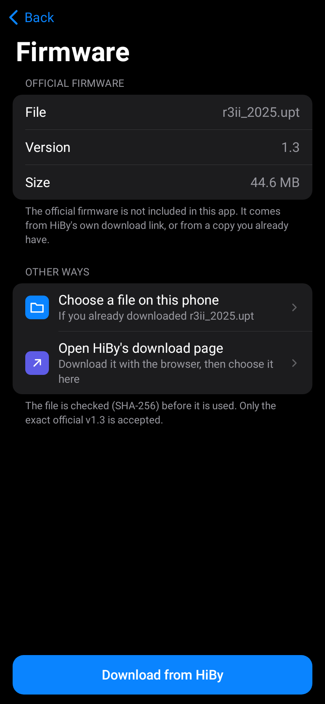
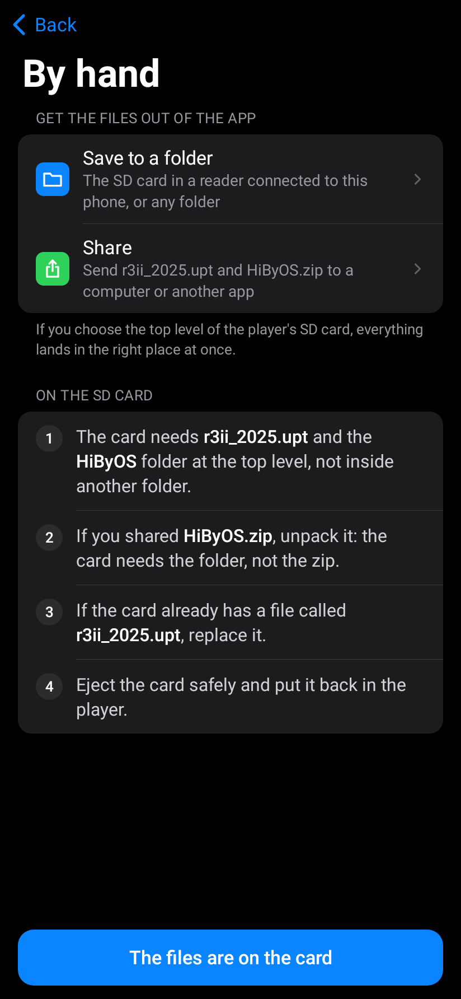

# ByOS Install (Android)

An Android app that puts [ByOS](https://github.com/Grohle/hibyos) on a **HiBy R3 II (2025)**
without a computer.

> **Before anything else: your HiBy R3 II (2025) must already be running the official firmware v1.3.**
> The app starts from *your own* copy of HiBy's official v1.3 firmware. It does not contain any
> HiBy firmware and it does not work with any other version or any other player.

## What it does

1. **Firmware.** Downloads the official firmware v1.3 (`r3ii_2025.upt`, 44.6 MB) from HiBy's own
   download link, or lets you choose a copy you already downloaded. The file is checked
   (SHA-256); only the exact official v1.3 is accepted.
2. **Build.** Turns that file into ByOS on the phone. The result is checked again before it is
   offered to you.
3. **Send.** Puts two things on the player's micro SD card: the new `r3ii_2025.upt` and a folder
   called `ByOS`. Over Wi-Fi with the player's own "Import Music via Wi-Fi" screen, or by hand
   with a card reader or a computer.
4. **Install.** You start the update from the player's own menu. The app shows the steps.

The APK contains only the ByOS project's own files and a list of changes to apply to the
official firmware. **It contains no HiBy firmware and no file of HiBy's.**

## What you need

- A **HiBy R3 II (2025)** on the **official firmware v1.3** (see "Check the version" below).
- A **micro SD card** in the player that the player already reads, with at least 100 MB free.
  ByOS keeps its apps and files in the `ByOS` folder of that card: leave the card in.
- The player's battery above 50 %.
- An Android phone or tablet with Android 8.0 or newer and about 250 MB free.
- For the Wi-Fi way: the phone and the player on the same Wi-Fi network.

## Check the version on the player

Menu names are those of the official firmware in English.

1. On the player's home screen, open **System**.
2. Scroll down the list and open **About**.
3. Read the line that starts with **BuildTime**. The official v1.3 shows **Mar 2 2026**.

If it shows something else, update the player to the official v1.3 first:

- With Wi-Fi on and a micro SD card in the player: **System › Firmware update › Via OTA**, or
- download the official v1.3 from
  [HiBy's page](https://store.hiby.com/apps/help-center#hc-r3-ii-2025-firmware-v13-update-not-available-in-r3-ii-2025-version),
  copy `r3ii_2025.upt` to the top level of the SD card and choose
  **System › Firmware update › Via SD-card**.

If the player is on, or offers, a version newer than v1.3, this version of the app does not
support it: look for a newer ByOS Install.

## Install the app

1. Download `hibyos-install-1.0.0.apk` from its release, **ByOS Install 1.0.0 (Android)**, on the project's
   [releases page](https://github.com/Grohle/hibyos/releases). It carries ByOS 0.8.0.
2. Check it (see "Check the APK" below).
3. Open the file on the phone. Android asks you to allow installing apps from that source: allow
   it, then tap **Install**.

## Step by step

### 1. Firmware

Tap **Download from HiBy**, or **Choose a file on this phone** if you already have
`r3ii_2025.upt`. The app checks the file and tells you if it is not the official v1.3.



### 2. Build

Tap **Build ByOS**. It takes less than a minute. Nothing is sent anywhere: the work is done on
the phone.

### 3. Send: over Wi-Fi

On the player (official firmware, menus in English):

1. On the player's home screen, open **Wireless › Wi-Fi**, turn Wi-Fi on and join the same
   network as the phone.
2. Go back to **Wireless** and open **Import Music via Wi-Fi**.
3. The player shows **Receive songs via Wi-Fi** and an address like `http://192.168.1.20:4399`.
   Keep that screen open until the app has finished (music stops while it is open).

In the app:

4. Type that address (the numbers are enough, for example `192.168.1.20`) and tap **Connect**.
   Or tap **Find my player**: only then does the app ask the devices of your own Wi-Fi network, on
   port 4399 only, which one is the player.
5. Tap **Send**. The app creates the `ByOS` folder on the card, sends every file, and reads
   each one back to check it arrived intact. If the connection breaks, tap **Try again**: files
   that already arrived are not sent twice.

### 3. Send: by hand

If Wi-Fi does not work for you:

1. In the app choose **By hand**, then **Save to a folder** (pick the SD card if it is in a card
   reader connected to the phone) or **Share** (to send the files to a computer).
2. The card needs `r3ii_2025.upt` and the `ByOS` folder at the top level, not inside another
   folder. If you shared `ByOS.zip`, unpack it: the card needs the folder, not the zip.
3. Eject the card safely and put it back in the player.



### 4. Install on the player

1. If the **Receive songs via Wi-Fi** screen is still open, leave it.
2. Go to the home screen and open **System › Firmware update**.
3. Choose **Via SD-card** and confirm **Update system firmware?**
4. Wait. The player installs the update and restarts by itself. Do not switch it off.
5. ByOS starts and finishes setting itself up from the card. Keep the `ByOS` folder on the
   card from now on.

If the player says "No firmware update file found!", it does not see `r3ii_2025.upt` at the top
level of the card.

## Check the APK

**SHA-256 of `hibyos-install-1.0.0.apk`:**

```
2988c2836c632093794f2a2aecf788d8e682a729af3b2937275b905490845722
```

- Windows (PowerShell): `Get-FileHash hibyos-install-1.0.0.apk -Algorithm SHA256`
- macOS / Linux: `shasum -a 256 hibyos-install-1.0.0.apk`

**SHA-256 fingerprint of the signing certificate** (`CN=HiByOS Install, O=HiByOS`: the project's former name; the certificate cannot change without breaking updates):

```
2526c1b0e7a578d626888b0b9da789808980177dd46d534477e3980c0c93eef9
```

With the Android SDK build tools: `apksigner verify --print-certs hibyos-install-1.0.0.apk`
and compare the line "Signer #1 certificate SHA-256 digest". Every later version of the app is
signed with the same certificate, so Android refuses an update signed by anyone else.

## What the app sends over the network

- **To HiBy's download link** (Google Drive, HTTPS): one download of the official firmware, only
  when you tap **Download from HiBy**.
- **To GitHub** (HTTPS): only when you tap **Check for newer ByOS files** on the About screen.
  It downloads a small signed list and, if you accept, the newer ByOS files. They are used
  only if their signature (Ed25519, the project's release key) and SHA-256 are right.
- **To your player**, inside your own Wi-Fi network, on port 4399: the files of step 3. With
  **Find my player**, a connection attempt to port 4399 of the addresses of your own network.
- Nothing else. No account, no analytics, no advertising, no crash reports. The app has only the
  "internet" and "network state" permissions; it cannot read your files, except the one you
  choose.

## Troubleshooting

| What you see | What to do |
|---|---|
| "This is not the official firmware v1.3" | The file is another version, another model, or a broken download. Get it again from HiBy's page. |
| "The player does not answer" | The player must still show **Receive songs via Wi-Fi**; both devices on the same Wi-Fi; type the address exactly as on its screen. |
| "No player found on this Wi-Fi network" | Guest networks often keep devices apart. Type the address by hand, or use the manual way. |
| "The player has no SD card it can use" | Put a micro SD card in the player, leave "Import Music via Wi-Fi" and open it again. |
| "The player refused a file" | The card may be full or write-protected. Free 100 MB and try again, or use the manual way. |
| "The connection to the player broke" | Keep the player on its Wi-Fi screen and near the router, then **Try again**. |
| "No firmware update file found!" (on the player) | `r3ii_2025.upt` is not at the top level of the card. |

## Build from source

You need JDK 21, the Android SDK (platform 36, `ANDROID_HOME` set) and, to produce the ByOS
files, Python 3 and a built ByOS tree (the repository this folder lives in).

```
cd android/hibyos-install
./gradlew :app:assembleRelease
```

- The ByOS files that go into the APK (`app/src/main/assets/hibyos-bundle.zip`) are made by
  `tools/export_bundle.py` from the project's Python definitions (`tools/hibyos_patcher.py`,
  `tools/build.py`, `tools/vendor_edits.json`). The build runs it when the bundle is missing.
  To use a ready-made bundle instead (for example the one of a release):
  `./gradlew :app:assembleRelease -PhibyosBundle=/path/to/hibyos-install-bundle-0.6.1.zip`
- The release is signed when `~/.hibyos/keys/hibyos-install.properties` exists (`storeFile`,
  `storePassword`, `keyAlias`, `keyPassword`; or point `HIBYOS_INSTALL_KEYSTORE_PROPERTIES` to
  another file). Without it the release APK is left unsigned. The keystore is never kept in the
  repository.
- Tests: `./gradlew :core:test` (the patcher, the LZO and squashfs code, the Wi-Fi sender against
  a mock player). With `HIBYOS_FIRMWARE=<your r3ii_2025.upt>`, `HIBYOS_REPO=<repository>` and
  `HIBYOS_PYTHON=<python with pycdlib>` it also checks that the app's result is byte for byte the
  one of `tools/hibyos_patcher.py`. `./gradlew :app:testDebugUnitTest` draws every screen into
  `docs/screens`.
- `byos-cli` (`./gradlew :cli:fatJar`, module `cli/`) carries the same bundle and the same core
  build code (`core/.../Build.kt`): `firmware-fetch`, `build` and `build-send --install` build ByOS
  on a computer and install it over USB; the desktop app uses them (docs/BYOS_CLI.md, "Build ByOS").

### Publishing newer ByOS files for the app

`tools/export_bundle.py` also writes `build/hibyos-install-bundle-<version>.zip` and
`build/hibyos-install-bundle.json`. Sign the `.json` with the release key
(`tools/ota_sign.py sign`) and attach both, with the signature, to the GitHub release.

## Licence

GPL-3.0-or-later, like the rest of ByOS. The licences of everything ByOS includes are in the
app: **About › Open-source licences**. HiBy and R3 II are names of their owner; this project is
not affiliated with HiBy.
