# HiByOS apps

HiByOS ships a set of built-in apps (compiled into the shell, `src/`) and supports external
apps packaged as `.hpk` files (installed from the **Apps** store or from the SD card). Each app
below has its own page with screenshots, a how-to, its settings, known limitations and
technical notes.

  
  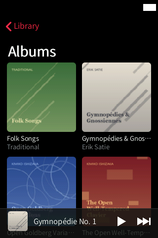
  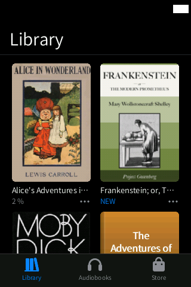
  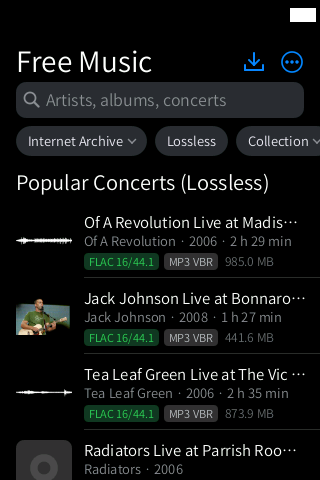
  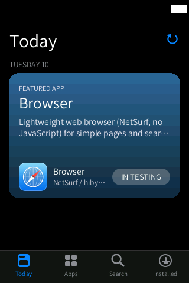

## App index

| | App | What it does | Status | Page |
|---|---|---|---|---|
|  | **Music** | Apple Music-style library: albums, artists, songs, genres, playlists, mixes, search, Now Playing with synced lyrics, tag editor | Beta | [music/](music/README.md) |
|  | **Files** | Finder-style file manager for the SD card and internal storage, with image viewer and text editor | Stable | [files/](files/README.md) |
|  | **Books** | EPUB / TXT reader in the style of Apple Books, plus LibriVox audiobooks and Project Gutenberg books | Beta | [books/](books/README.md) |
|  | **Free Music** | Search, listen to and download free / Creative Commons music from the Internet Archive and Jamendo | Beta | [freemusic/](freemusic/README.md) |
|  | **Settings** | iOS-style settings: the player's sound and system settings, USB DAC, home screen, gestures, Control Centre, keyboard, developer | Beta | [settings/](settings/README.md) |
|  | **Wireless** | Wi-Fi and Bluetooth in the style of iOS Settings, without HiBy's app | Experimental | [wireless/](wireless/README.md) |
|  | **Apps** | App store: repositories, `.hpk` packages from the SD card, install on the SD card or the HiBy, backups | Beta | [store/](store/README.md) |
| (no icon yet) | **Headphones** | Battery, noise control, EQ and gestures for AirPods / Beats, Galaxy Buds, Nothing / CMF, Sony and Fast Pair headsets | In development | [headphones/](headphones/README.md) |
|  | **Browser** | Lightweight NetSurf web browser (external `.hpk`) | Experimental (blocked) | [navegador/](navegador/README.md) |
|  | **Hello** | Example external app for developers: the smallest complete `.hpk` | Stable (example) | [hola/](hola/README.md) |

Status legend:

- **Stable**: in daily use on the device.
- **Beta**: complete, but some parts have not been verified on the device yet (each page
  says which).
- **Experimental**: works off the device (PC tests, QEMU harness) but has not been run on the
  HiBy, or is blocked.
- **In development**: being written; not part of a release yet.

Other home screen icons: **USB DAC** opens Settings › USB, **Now Playing** opens the Music
app's player, **Customize** opens Settings, and **Radio**, **Tidal** and **Qobuz** are HiBy's
own apps.

## System features

The gestures and system screens are shared by every app.

  
  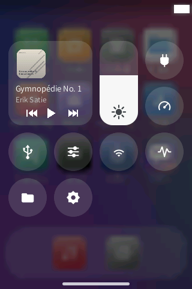
  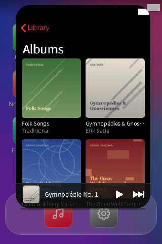
  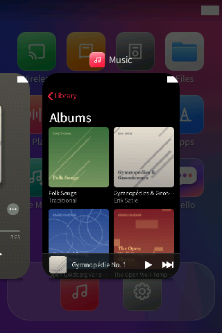
  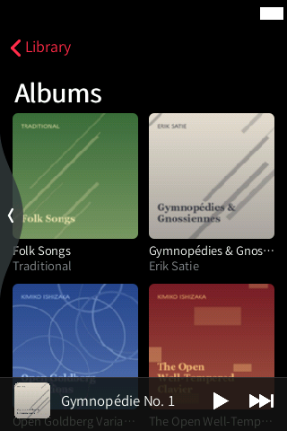

| Gesture (defaults) | What it does |
|---|---|
| Swipe in from the **left or right edge** | Back. A bubble follows your finger; let go past it to go back |
| Swipe **up from the bottom bar** | Home: the app shrinks into its icon |
| Swipe up from the bottom bar and **hold still for 1 s** | Multitasking: the current app and the player as cards |
| Swipe **down from the top-left** | Control Centre |
| Swipe **down from the top-right** | The player |
| On the home screen, swipe **right** | Widgets page |
| **Long-press** an icon or a widget | Edit mode (jiggle): move, remove, add widgets, then **Done** |

Every gesture can be changed in Settings › Gestures (see [settings/](settings/README.md)).

  
  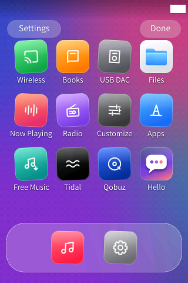
  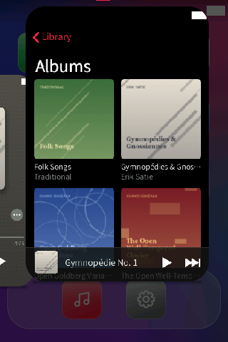
  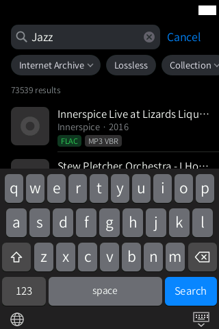

## About the screenshots

The screenshots on these pages were taken in the QEMU harness (`docs/VM_SHELL.md`), which runs
the real `hibyshell` binary unmodified, in English. The demo library uses public-domain works
and CC0 recordings as names, with silent audio files; the books are public-domain EPUBs from
Project Gutenberg; the Free Music and audiobook screens show live results from the Internet
Archive. Because the harness has no real player:

- the white box at the top right is the harness placeholder for the status bar;
- Now Playing shows the last played track, paused, with no elapsed time;
- battery levels, Wi-Fi and Bluetooth are not available (shown as off or 0 %).

The Headphones screenshots are PC renders of the in-development app with simulated headphones
(`tests/buds_render.sh`).

## Other folders in `apps/`

| Folder | What it is |
|---|---|
| `hola/` | Source of the example app (see above) |
| `navegador/` | Build files of the Browser app |
| `netsurf-hiby/` | NetSurf port used by the Browser (build scripts, framebuffer backend, resources) |
| `harness_vm/` | QEMU harness used for testing and for these screenshots (`docs/VM_SHELL.md`) |
| `fbtouch/` | Small framebuffer / touch test tool |

To write your own app, start with [hola/](hola/README.md) and `docs/APP_FORMAT.md`.
