# HiByOS apps

HiByOS ships a set of built-in apps (compiled into the shell, `src/`) and supports external
apps packaged as `.hpk` files (installed from the **Apps** store or from the SD card). Each app
below has its own page with screenshots, a how-to, its settings, known limitations and
technical notes.

  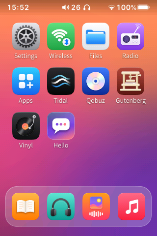
  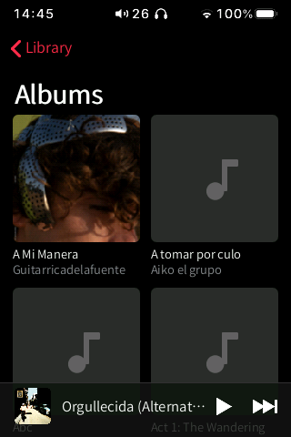
  
  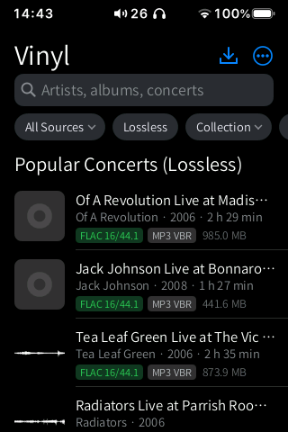
  

## App index

| | App | What it does | Status | Page |
|---|---|---|---|---|
|  | **Music** | Apple Music-style library: albums, artists, songs, genres, playlists, mixes, search, Now Playing with synced lyrics, tag editor | Beta | [music/](music/README.md) |
|  | **Files** | Finder-style file manager for the SD card and internal storage, with image viewer and text editor | Stable | [files/](files/README.md) |
|  | **Books** | EPUB / TXT reader in the style of Apple Books, audiobooks, and an Explore tab with Project Gutenberg, LibriVox and OPDS catalogs you add | Beta | [books/](books/README.md) |
|  | **Gutenberg** | Project Gutenberg books and LibriVox audiobooks: search, download, read and listen | Beta | [gutenberg/](gutenberg/README.md) |
|  | **Vinyl** | Search, listen to and download free / Creative Commons music from the Internet Archive, Jamendo and your own sources, with format and quality | Beta | [freemusic/](freemusic/README.md) |
| 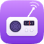 | **Radio** | Internet radio: the Radio Browser directory, a built-in list of European public radio (HLS included), your own sources and stations | Beta | [docs/RADIO.md](../docs/RADIO.md) |
|  | **Settings** | iOS-style settings: the player's sound and system settings, USB DAC, home screen, gestures, Control Center, keyboard, developer | Beta | [settings/](settings/README.md) |
| 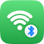 | **Wireless** | Wi-Fi and Bluetooth in the style of iOS Settings, without HiBy's app | Beta | [wireless/](wireless/README.md) |
|  | **Apps** | App store: repositories, `.hpk` packages from the SD card, install on the SD card or the HiBy, backups | Beta | [store/](store/README.md) |
| 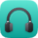 | **Headphones** | Battery, noise control, EQ and gestures for AirPods / Beats, Galaxy Buds, Nothing / CMF, Sony, Soundcore and Fast Pair headsets | In development | [headphones/](headphones/README.md) |
|  | **Browser** | Lightweight NetSurf web browser (external `.hpk`) | Experimental (blocked) | [navegador/](navegador/README.md) |
|  | **Hello** | Example external app for developers: the smallest complete `.hpk` | Stable (example) | [hola/](hola/README.md) |

Status legend:

- **Stable**: in daily use on the device.
- **Beta**: complete, but some parts have not been verified on the device yet (each page
  says which).
- **Experimental**: works off the device (PC tests, QEMU harness) but has not been run on the
  HiBy, or is blocked.
- **In development**: being written; not part of a release yet.

Other home screen icons: **Now Playing** opens the player on its own, and **Tidal** and
**Qobuz** are HiBy's own apps (with the HiByOS gestures and status bar). The old
**Customize** app is now part of Settings (Personalization). Gutenberg, Vinyl, Headphones and
Hello come preinstalled but are listed in **Apps**, where they can be uninstalled and
reinstalled like any other app.

## System features

The gestures and system screens are shared by every app.

  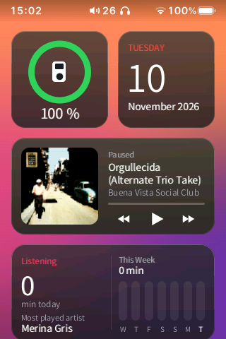
  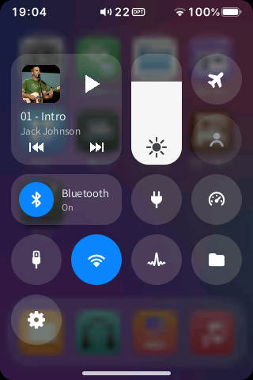
  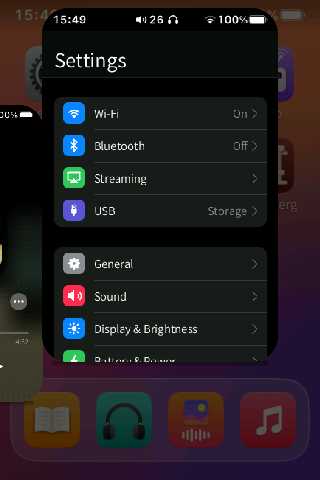
  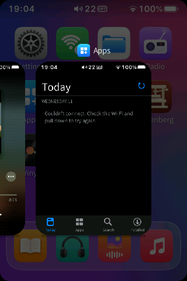
  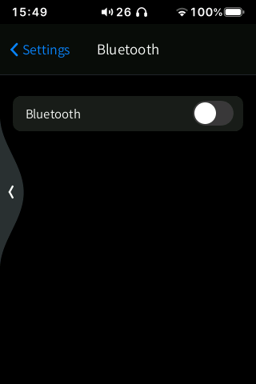

| Gesture (defaults) | What it does |
|---|---|
| Swipe in from the **left or right edge** | Back. A bubble follows your finger; let go past it to go back |
| Swipe **up from the bottom bar** | Home: the app shrinks into its icon |
| Swipe up from the bottom bar and **hold still for 1 s** | Multitasking: the current app and the player as cards |
| Swipe **down from the top-left** | Control Center |
| Swipe **down from the top-right** | The player |
| On the home screen, swipe **right** | Widgets page |
| **Long-press** an icon | App menu: **Open**, **Edit Home Screen**, **Uninstall** |
| **Long-press** a widget, or choose **Edit Home Screen** | Edit mode (jiggle): move, remove, add widgets, then **Done** |

Every gesture can be changed in Settings › Gestures (see [settings/](settings/README.md)).

  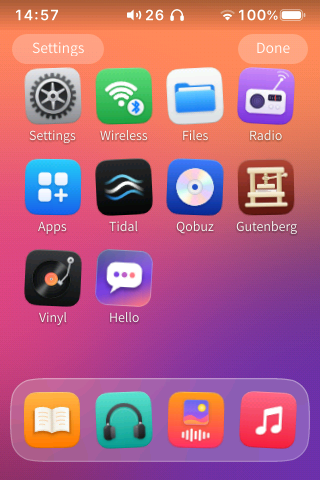
  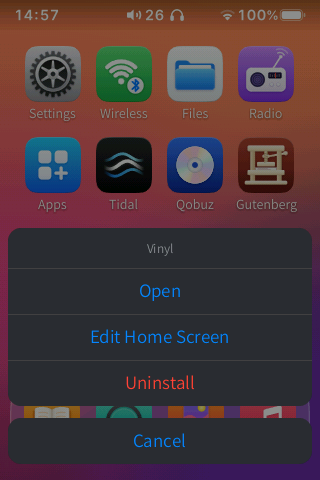
  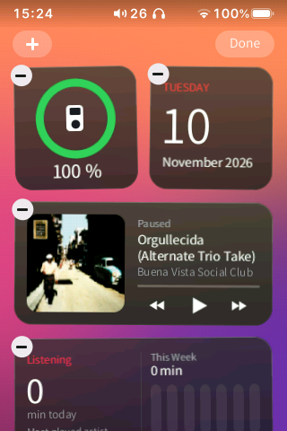
  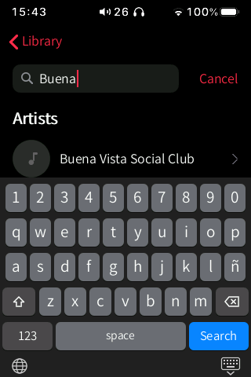

## About the screenshots

The screenshots on these pages were taken in English on a real HiBy R3 II (2025) running
HiByOS, with the player's own music library and live results from the online sources. Wi-Fi
network names, IP and MAC addresses are blurred. The Headphones screenshots show the app with
no headphones connected; the per-model pages are PC renders (`tests/buds_render.sh`).

## Other folders in `apps/`

| Folder | What it is |
|---|---|
| `hola/` | Source of the example app (see above) |
| `navegador/` | Build files of the Browser app |
| `netsurf-hiby/` | NetSurf port used by the Browser (build scripts, framebuffer backend, resources) |
| `harness_vm/` | QEMU harness used for off-device testing (`docs/VM_SHELL.md`) |
| `fbtouch/` | Small framebuffer / touch test tool |

To write your own app, start with [hola/](hola/README.md) and `docs/APP_FORMAT.md`.
