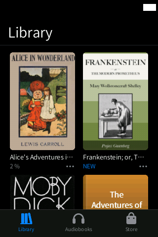
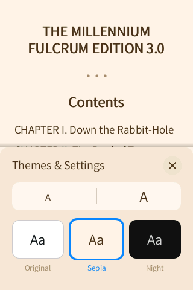
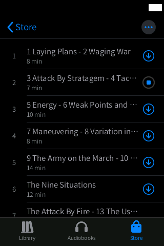
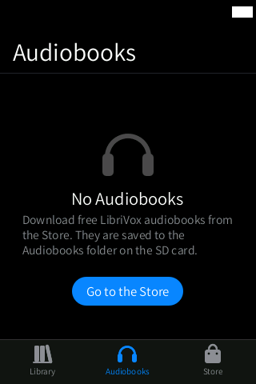

# Books

**An Apple Books-style reader for EPUB and TXT books, with free public-domain audiobooks from
LibriVox and ebooks from Project Gutenberg. It replaces HiBy's reader, which only read TXT
files.**

  
  
  
  
  

Status: **Beta**. The reader is complete; the Audiobooks and Store tabs are new and audiobook
playback is still being verified on the device.

## Features

Three tabs at the bottom: **Library**, **Audiobooks** and **Store**.

### Library and reader

- A grid of covers (the EPUB's own cover, or one generated from the title and author), sorted
  by recent reading, with reading progress ("2 %") or **NEW**.
- **⋯** on a book: Mark as Finished / Not Read, Start from the Beginning, Delete.
- Pages turn with the Apple Books slide: they follow your finger with inertia; tap the left or
  right edge to turn a page.
- Tap the middle of the page for the controls: close, title, page number, progress bar and the
  menu (**Contents** and **Themes & Settings**).
- **Themes & Settings**: text size (A / A, 8 sizes) and three themes: **Original**, **Sepia**
  and **Night**.
- **Swipe down** on a page to close the book (it shrinks back into its cover).
- The position is remembered per book.
- EPUB 2 and 3 (chapters, italic and bold, table of contents) and plain TXT.

### Audiobooks

- A grid of the downloaded audiobooks with cover and progress, and downloads in progress.
- Tap one to play it from where you left off: it is sent to the HiBy player in chapter order
  and our Now Playing opens. While it plays, a mini player sits above the tab bar.

### Store

- **Audiobooks**: public-domain audiobooks read by LibriVox volunteers (catalogue on
  archive.org), with **Popular** / **New** lists, a search bar and a language picker
  (defaults to the interface language).
- **Books**: public-domain EPUBs from Project Gutenberg (through Gutendex), with search and
  language.
- **Audiobook page**: cover, author, length, size, number of chapters, description and the
  chapter list with durations. **Download** gets the whole book, or tap ⬇ next to one chapter.
  A progress ring shows each download; you can pause, cancel and delete.
- Downloads run in a separate process and continue after you leave Books.

  
  
  
  
  
  

## How to use

1. Copy `.epub` or `.txt` files to a **`Books`** folder on the SD card (also recognised:
   `book` (HiBy's folder), `eBooks`, `Libros`, `Livres` and the same names in other
   languages; loose `.epub` files at the root of the SD card are found too).
2. Open **Books**. Covers and titles appear after a moment (they are read in the
   background).
3. Tap a book to open it. Tap the right edge (or swipe left) for the next page.
4. Tap the middle of the page, then the **☰** button › **Themes & Settings** to change the
   size or the theme, or **Contents** to jump to a chapter.
5. Swipe down to close the book.
6. **Audiobooks**: open the **Store** tab, keep **Audiobooks** selected, pick a book, then
   **Download** (or ⬇ on one chapter). It appears in the **Audiobooks** tab; tap it to play.
7. **Ebooks**: in the **Store** tab choose **Books**, search, and download: the EPUB goes to
   `SD/Books/` and shows up in the Library.

System gestures: back from either edge; swipe up from the bottom bar to go home; swipe up and
hold still for 1 s for multitasking.

## Settings and options

- Reader: text size and theme (saved for all books).
- Store: language of the catalogue (saved in the Books settings).

## Tips

- Gutendex (the Project Gutenberg catalogue service) can be slow: the app warns that it "can
  take up to a minute to respond".
- Downloading a single chapter is a good way to try a long audiobook.
- Audiobooks are ordinary MP3 folders on the SD card: you can copy them to a computer.

## Limitations / known issues

- Audiobook playback goes through the stock player's play-list API (display library v6) and
  is still being verified on the device.
- No highlights, notes or bookmarks yet.
- The Store needs Wi-Fi. When the screenshots were taken, Gutendex did not answer (from the
  computer either), so the Books store is not pictured.
- Found while taking these screenshots (QEMU harness):
  - on the first scan, the EPUB covers were not extracted and a generated cover was shown
    instead; the failure is remembered in the index, so it was only retried after deleting
    `/usr/data/hibymod/appdata/books/index`. To be checked on the device.
  - with the controls shown, the small book title at the top overlaps the first heading of
    the page.

## Technical notes

| | |
|---|---|
| Source | `src/books.inc.c` (library, reader UI), `src/books_core.inc.c` (EPUB/ZIP/XHTML and TXT core, no UI; PC tests `tests/books_test.sh`), `src/books_draw.inc.c` (text layout), `src/books_ab.inc.c` (Audiobooks and Store tabs), `src/books_abcore.inc.c` (catalogue parsers and the download process; tests `tests/ab_test.sh`), `src/lang/books_tr.inc.c` (13 languages) |
| Helpers | `hibywall` (EPUB covers to RGB565), `hibynet` (catalogues and downloads); downloads run as `hibyshell --abdl` in its own process |
| Data | positions and settings `/usr/data/hibymod/appdata/books/` (`<hash>.pos`, `index`, covers `.cov`); store cache `/usr/data/hibymod/cache/ab/` |
| Files written | audiobooks `SD/Audiobooks/<Author> - <Title>/` (`NN - chapter.mp3`, `cover.jpg`, `book.json`); ebooks `SD/Books/<title>.epub` |
| Network | only in the Store tab: archive.org (LibriVox catalogue and files) and gutendex.com / gutenberg.org. No account |
| Performance | the current, previous and next pages are pre-rendered, so a page turn is a row copy; the whole-book pagination runs in a low-priority thread that pauses during animations; one chapter in memory at a time (streamed inflate), about 0.9 MB while a book is open |

## Links

- [All apps](../README.md)
- [Music](../music/README.md) (Now Playing is shared)
