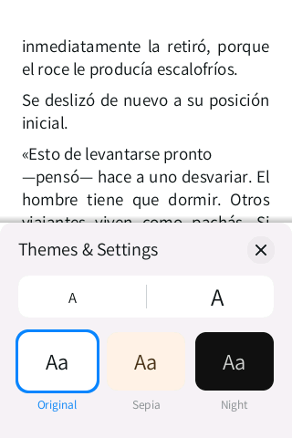
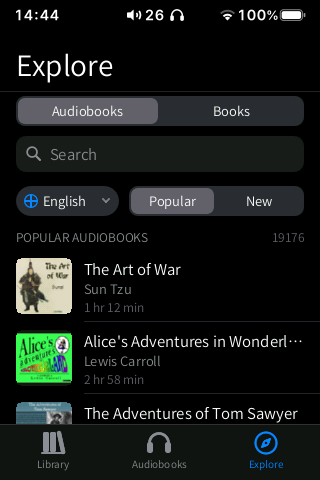
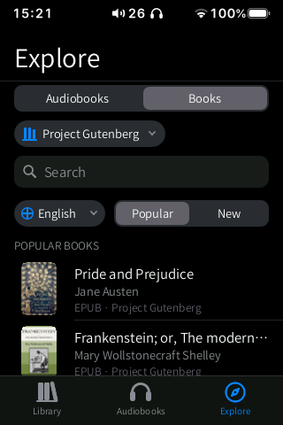
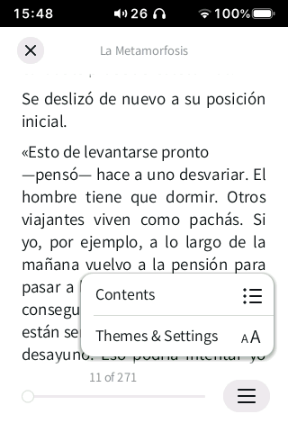
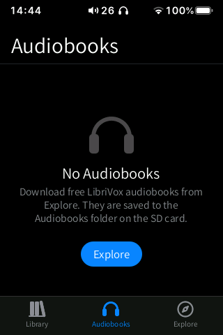
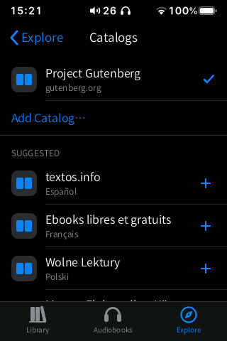
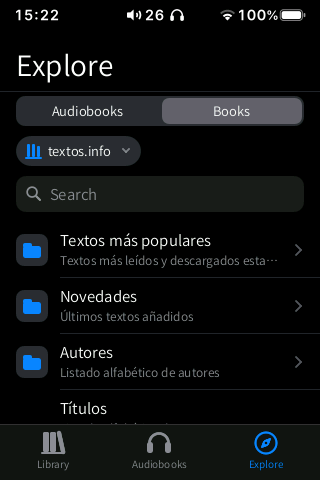
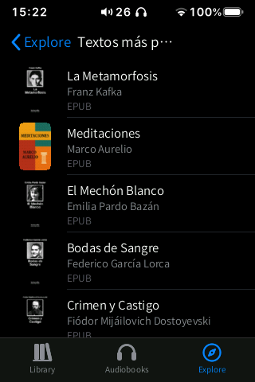
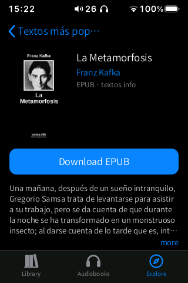

# Books

**An Apple Books-style reader for EPUB and TXT books, with free public-domain audiobooks from
LibriVox and ebooks from Project Gutenberg. It replaces HiBy's reader, which only read TXT
files.**

  
  
  
  
  

Status: **Beta**. The reader is complete; the Audiobooks and Store tabs are new and audiobook
playback is still being verified on the device.

## Features

Three tabs at the bottom: **Library**, **Audiobooks** and **Store**.

### Library and reader

- A grid of covers (the EPUB's own cover, or one generated from the title and author), sorted
  by recent reading, with reading progress ("2 %") or **NEW**.
- **⋯** on a book: Mark as Finished / Not Read, Start from the Beginning, Delete.
- Pages turn with the Apple Books slide: they follow your finger with inertia; tap the left or
  right edge to turn a page.
- Tap the middle of the page for the controls: close, title, page number, progress bar and the
  menu (**Contents** and **Themes & Settings**).
- **Themes & Settings**: text size (A / A, 8 sizes) and three themes: **Original**, **Sepia**
  and **Night**.
- **Swipe down** on a page to close the book (it shrinks back into its cover).
- The position is remembered per book.
- EPUB 2 and 3 (chapters, italic and bold, table of contents) and plain TXT.

### Audiobooks

- A grid of the downloaded audiobooks with cover and progress, and downloads in progress.
- Tap one to play it from where you left off: it is sent to the HiBy player in chapter order
  and our Now Playing opens. While it plays, a mini player sits above the tab bar.

### Store

- **Audiobooks**: public-domain audiobooks read by LibriVox volunteers (catalogue on
  archive.org), with **Popular** / **New** lists, a search bar and a language picker
  (defaults to the interface language).
- **Books**: public-domain EPUBs from Project Gutenberg (through Gutendex), with search and
  language.
- **Audiobook page**: cover, author, length, size, number of chapters, description and the
  chapter list with durations. **Download** gets the whole book, or tap ⬇ next to one chapter.
  A progress ring shows each download; you can pause, cancel and delete.
- Downloads run in a separate process and continue after you leave Books.

### Catalogs (your own book sources)

Besides Project Gutenberg, the **Books** side of Explore can browse any **OPDS 1.x** catalog:
Calibre-Web, COPS, Kavita, Komga, or a public library that publishes one.

1. In **Explore** › **Books**, tap the pill with the name of the catalog in use
   (**Project Gutenberg** at first). The **Catalogs** page opens.
2. Tap **Add Catalog…** and type its address, for example `https://example.org/opds`
   (leave out `https://` or `http://` and both are tried; the address of the web page of a
   Calibre-Web or COPS server works too when it links to its catalog). The address is checked
   while a spinner turns; if it is not a catalog you are told why and nothing is added.
3. The new catalog becomes the one in use. Go back: its folders and books are listed in
   Explore. Folders open their own page, long lists load their next page as you scroll, and
   the search bar appears only when the catalog offers a search.
4. A book page shows its summary and a **Download** button: the EPUB goes to `SD/Books/` and
   to the Library, like the ones from Project Gutenberg. Entries without an EPUB are shown
   with **No EPUB available**.
5. To switch, tap a catalog in the **Catalogs** page. To remove one, touch and hold it.
   Project Gutenberg cannot be removed.

**Suggested** lists a few free catalogs to add with one tap. Each one was checked on
2026-11-10 to answer without an account and to offer EPUB files:

| Catalog | Language | Address |
|---|---|---|
| textos.info | Spanish | `https://www.textos.info/catalogo.atom` |
| Ebooks libres et gratuits | French | `https://www.ebooksgratuits.com/opds/` |
| Wolne Lektury | Polish | `https://wolnelektury.pl/opds/` |
| Magyar Elektronikus Könyvtár | Hungarian | `https://mek.oszk.hu/opds/` |
| unglue.it | English (Creative Commons) | `https://unglue.it/api/opds/` |

Limits:

- **No sign-in.** `hibynet` has no HTTP authentication, so catalogs that ask for a user name
  and password do not work, and no password is ever stored (a `user:password@` part typed in
  an address is dropped).
- OPDS 1.x (Atom) only: OPDS 2.0 (JSON) catalogs are not read.
- EPUB only; other formats of an entry are ignored.
- Up to 12 catalogs. The language picker and **Popular** / **New** belong to Project
  Gutenberg and are hidden in other catalogs.

The list is kept in `/usr/data/hibymod/appdata/books/catalogs.tsv` (plain text, one catalog
per line: address, last status, name, search template).

  
  
  
  
  
  

## How to use

1. Copy `.epub` or `.txt` files to a **`Books`** folder on the SD card (also recognised:
   `book` (HiBy's folder), `eBooks`, `Libros`, `Livres` and the same names in other
   languages; loose `.epub` files at the root of the SD card are found too).
2. Open **Books**. Covers and titles appear after a moment (they are read in the
   background).
3. Tap a book to open it. Tap the right edge (or swipe left) for the next page.
4. Tap the middle of the page, then the **☰** button › **Themes & Settings** to change the
   size or the theme, or **Contents** to jump to a chapter.
5. Swipe down to close the book.
6. **Audiobooks**: open the **Store** tab, keep **Audiobooks** selected, pick a book, then
   **Download** (or ⬇ on one chapter). It appears in the **Audiobooks** tab; tap it to play.
7. **Ebooks**: in the **Store** tab choose **Books**, search, and download: the EPUB goes to
   `SD/Books/` and shows up in the Library.

System gestures: back from either edge; swipe up from the bottom bar to go home; swipe up and
hold still for 1 s for multitasking.

## Settings and options

- Reader: text size and theme (saved for all books).
- Store: language of the catalogue (saved in the Books settings).

## Tips

- Gutendex (the Project Gutenberg catalogue service) can be slow: the app warns that it "can
  take up to a minute to respond".
- Downloading a single chapter is a good way to try a long audiobook.
- Audiobooks are ordinary MP3 folders on the SD card: you can copy them to a computer.

## Limitations / known issues

- Audiobook playback goes through the stock player's play-list API (display library v6) and
  is still being verified on the device.
- No highlights, notes or bookmarks yet.
- Explore needs Wi-Fi.
- Found during testing:
  - on the first scan, the EPUB covers were not extracted and a generated cover was shown
    instead; the failure is remembered in the index, so it was only retried after deleting
    `/usr/data/hibymod/appdata/books/index`. To be checked on the device.
  - with the controls shown, the small book title at the top overlaps the first heading of
    the page.

## Technical notes

| | |
|---|---|
| Source | `src/books.inc.c` (library, reader UI), `src/books_core.inc.c` (EPUB/ZIP/XHTML and TXT core, no UI; PC tests `tests/books_test.sh`), `src/books_draw.inc.c` (text layout), `src/books_ab.inc.c` (Audiobooks and Store tabs), `src/books_abcore.inc.c` (catalogue parsers and the download process; tests `tests/ab_test.sh`), `src/lang/books_tr.inc.c` (13 languages) |
| Helpers | `hibywall` (EPUB covers to RGB565), `hibynet` (catalogues and downloads); downloads run as `hibyshell --abdl` in its own process |
| Data | positions and settings `/usr/data/hibymod/appdata/books/` (`<hash>.pos`, `index`, covers `.cov`); store cache `/usr/data/hibymod/cache/ab/` |
| Files written | audiobooks `SD/Audiobooks/<Author> - <Title>/` (`NN - chapter.mp3`, `cover.jpg`, `book.json`); ebooks `SD/Books/<title>.epub` |
| Network | only in the Store tab: archive.org (LibriVox catalogue and files) and gutendex.com / gutenberg.org. No account |
| Performance | the current, previous and next pages are pre-rendered, so a page turn is a row copy; the whole-book pagination runs in a low-priority thread that pauses during animations; one chapter in memory at a time (streamed inflate), about 0.9 MB while a book is open |

## Links

- [All apps](../README.md)
- [Music](../music/README.md) (Now Playing is shared)
