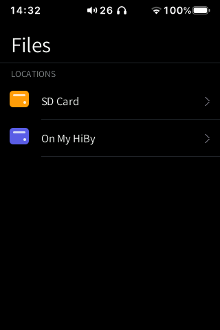
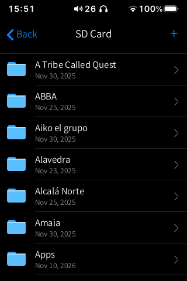
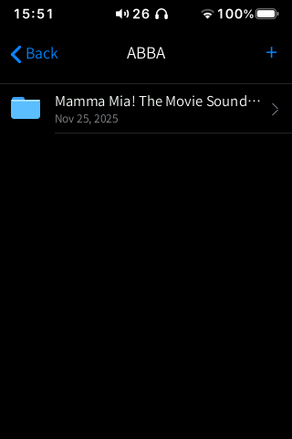
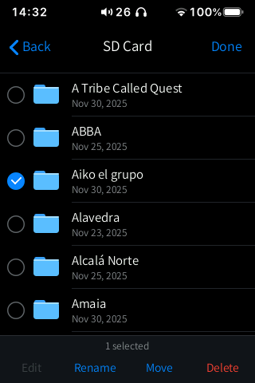

# Files

**A Finder / iOS Files-style file manager for the SD card and the HiBy's internal storage,
with an image viewer, a text editor and multi-select.**

  
  
  
  

Status: **Stable**.

## Features

- **Locations**: **SD Card** and **On My HiBy** (a safe internal folder,
  `/usr/data/hibymod/archivos`, so you cannot damage the system files).
- Lists with an icon per file type (folder, audio, image, text), size and date; folders first,
  then by name; iOS inertia scrolling.
- Folders open with the iOS push animation.
- **Long-press** a row to enter selection mode, then tap more rows. The bottom bar offers:
  - **Edit**: opens the tag editor for the selected audio files (one or many);
  - **Rename** (one item);
  - **Move**: choose the destination folder (on the same storage), then **Move Here**;
  - **Delete**, with confirmation and a progress card.
- **+** at the top right: new folder, named with the HiByOS keyboard.
- **Image viewer** (JPEG, PNG, BMP, GIF): swipe left / right for the previous / next image.
- **Text viewer and editor** for `.txt`, `.lrc`, `.cue`, `.m3u`, `.json`, `.ini`, `.md` and
  similar files: tap **Edit**, type, then **Save** (written atomically).
- When the SD card is connected to a computer over USB, the app says so instead of showing an
  empty card.

## How to use

1. Open **Files** from the home screen.
2. Tap **SD Card** or **On My HiBy**, then tap folders to go deeper.
3. Go back with **‹ Back**, or swipe in from the left or right edge.
4. Tap an image to view it; swipe sideways for the next one; **‹** to close it.
5. Tap a text file to read it; **Edit** to change it, **Save** to keep the changes.
6. **Long-press** a file to select it, tap others to add them, then choose **Edit**,
   **Rename**, **Move** or **Delete**. **Done** leaves selection mode.
7. Tap **+** to create a folder.

System gestures: back from either edge; swipe up from the bottom bar to go home; swipe up and
hold still for 1 s for multitasking.

## Settings and options

None of its own. The keyboard follows Settings › Keyboard (layout, height, number row).

## Tips

- To play music, use the **Music** app: tapping an audio file in Files shows a hint instead of
  playing it.
- To fix tags of a whole folder, long-press the first file, tap the others, then **Edit**.
- Wallpapers: put images in `SD/Pictures/`; Settings › Home Screen picks them up.

## Limitations / known issues

- Audio files are not played from Files (see Tips).
- No copy, only move. Moving is a rename, so it works inside one storage only: moving from the
  SD card to **On My HiBy** (or back) fails with "Couldn't move" ("Some items couldn't be
  moved").
- The internal location is limited to `/usr/data/hibymod/archivos`; the rest of the system is
  not shown on purpose. Internal storage has only about 24 MB free.
- Found in testing off the device: **in the text viewer, swiping up from the bottom bar may
  scroll the text instead of going home**; use **‹** first.

## Technical notes

| | |
|---|---|
| Source | `src/files.inc.c` (UI, viewers, file operations); keyboard `src/keyboard.inc.c`; tag editor `src/tageditor.inc.c` |
| Helpers | `hibywall` (decodes images to RGB565 for the viewer and the thumbnails), `hibytag` (through the tag editor) |
| Paths | SD card `/usr/data/mnt/sd_0`; internal `/usr/data/hibymod/archivos` |
| Limits | up to 5000 entries per folder |
| Network | none |

## Links

- [All apps](../README.md)
- [Music](../music/README.md) (tag editor, lyrics and covers)
