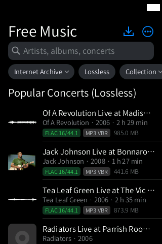
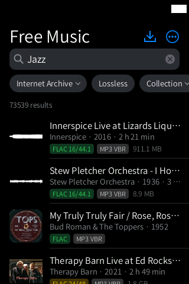
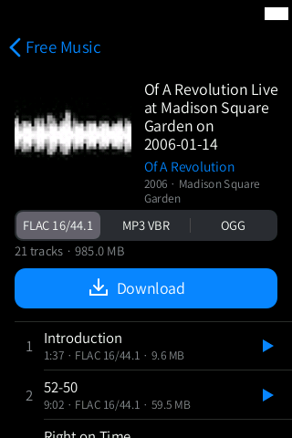
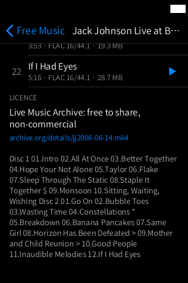
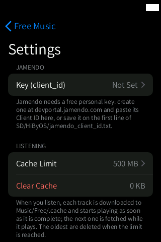
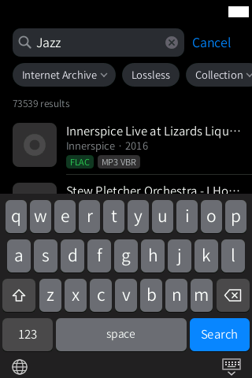
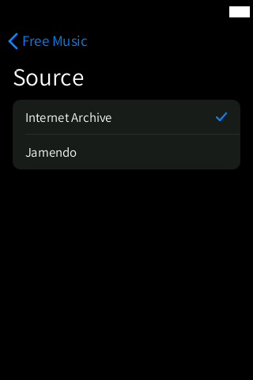
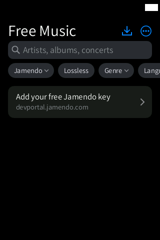
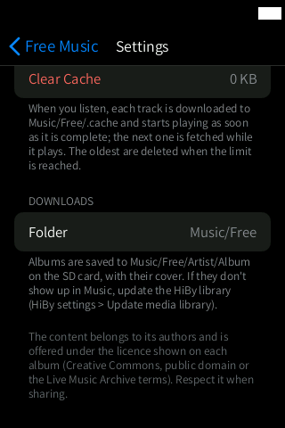

# Free Music

**Search, listen to and download free and Creative Commons music from the Internet Archive
and Jamendo, with the audio quality shown right in the search results.**

  
  
  
  
  

Status: **Beta**. Search, album pages, downloads and settings work (live data in the
screenshots); **Listen** hands unscanned files to the stock player, which still has to be
verified on the device.

## Features

- **Two sources** (first chip under the search bar):
  - **Internet Archive** (no key): Live Music Archive concerts, netlabels and community
    audio;
  - **Jamendo** (Creative Commons; needs a free personal key, see below).
- **Filters**: Lossless, Collection, Genre, Language and sort order.
- **Quality badges** in the results, without opening the album: `FLAC 24/96` (gold = high
  resolution), `FLAC 16/44.1` (green), `MP3 320`, `MP3 VBR`, `OGG`, plus size, year and total
  length. Sample rate and bit depth are read lazily from the first FLAC track, only for the rows
  on screen, and cached.
- **Album page**: cover, artist, year and venue, a format picker (e.g. `FLAC 16/44.1 | MP3 VBR
  | OGG`) with the number of tracks and total size, per-track duration, quality and size, the
  licence (`CC BY-NC-SA 3.0`, `CC0 1.0`, `Public Domain Mark`, the Live Music Archive terms...)
  and the item's web page.
- **Listen**: tap ▶ on a track. It is cached on the SD card and the album is handed to the
  HiBy player as soon as the first track is complete; the next track is fetched while it
  plays. A ring shows the track being prepared and bars show the one playing.
- **Download** the whole album in the chosen format. Downloads run one file at a time in the
  background (they keep going after you leave the app), are resumed when you reopen it, check
  the free space first and write the tags and a `cover.jpg`.
- **Downloads** page (the ⬇ button at the top): queue, progress, "Clear finished".

  
  
  
  

## How to use

1. Connect to Wi-Fi and insert an SD card.
2. Open **Free Music**. The start page shows popular lossless concerts.
3. Tap the search bar, type (for example `jazz`) and tap **Search**. Use the chips to filter
   (Lossless, Genre, Language...).
4. Tap a result to open the album page. Choose a format in the segmented control.
5. Tap ▶ on a track to **listen**, or **Download** for the whole album.
6. Follow your downloads with the ⬇ button at the top right.
7. When the downloads finish, update the HiBy library (see Tips) and find the album in
   **Music**.

System gestures: back from either edge; swipe up from the bottom bar to go home; swipe up and
hold still for 1 s for multitasking.

### Setting up Jamendo (free key)

1. On a computer or phone, open **https://devportal.jamendo.com**, sign up (free) and create
   an application (*My apps › Add a new app*, any name). Copy its **Client ID** (8 hexadecimal
   characters). The client secret is not needed.
2. Enter it in one of two ways:
   - in the app: **⋯** (top right) › **Key (client_id)**, type it and press OK; the app
     tests it at once ("Valid key" / "Invalid key" / "No connection"). **Test key** repeats the
     test and **Remove key** deletes it;
   - without typing: create the text file **`HiByOS/jamendo_client_id.txt`** on the SD card
     with the Client ID on the first line. The app reads it when it opens and copies it to its
     settings, so the file can then be deleted.
3. Choose **Jamendo** in the source chip. Without a key, Jamendo only shows the row "Add your
   free Jamendo key".

## Settings and options

**⋯** at the top right:

| Setting | What it does |
|---|---|
| Jamendo › Key (client_id) | your Jamendo key (see above) |
| Listening › Cache Limit | size of the listening cache, 250 MB to 4 GB (default 500 MB) |
| Listening › Clear Cache | empties the listening cache |
| Downloads › Folder | `Music/Free` on the SD card |

## Tips

- Downloaded albums are saved as `Music/Free/<Artist>/<Album>/NN - Title.ext` with their cover.
  They show up in **Music** after the HiBy rescans the SD card (stock settings › update media
  library, or Settings › Music Library › Find New Music Automatically).
- Albums larger than 1 GB ask for confirmation before downloading.
- On Jamendo, if the artist does not allow downloads the album says "Listen only" and Download
  is disabled; sizes there are estimates (≈).
- Respect the licence shown on each album when you share the music.

## Limitations / known issues

- **Listen** depends on the stock player accepting files it has not scanned, and on what it
  does when it reaches a track that is not cached yet: both still need to be verified on the
  device. There is no way to stream a URL into the stock player.
- New downloads need a library rescan before they appear in Music (`hibytag dbupdate` only
  updates rows that already exist).
- The Jamendo parsers were tested against synthetic samples built from the documented schema;
  a capture with a real key is still to be added.
- Needs Wi-Fi and an SD card.

## Technical notes

| | |
|---|---|
| Source | `src/freemusic.inc.c` (UI and threads), `src/freemusic_core.inc.c` (parsers, labels, URLs; PC tests `tests/freemusic_test.sh`), `src/lang/freemusic_tr.inc.c` (13 languages) |
| Helpers | `hibynet` (all HTTPS requests and downloads, in child processes), `hibytag` (tags of downloaded files, `HIBYTAG_NODB=1`) |
| Threads | two network workers (searches and pages; thumbnails, covers and FLAC probes) and one download worker for the whole shell session (nice 19, idle I/O class, so audio comes first). Nothing touches the network or the disk on the UI thread |
| Data | settings and Jamendo key `/usr/data/hibymod/appdata/freemusic/`; download queue `appdata/freemusic/queue.tsv`; HTTP cache `/usr/data/hibymod/cache/freemusic/` (FLAC probes in `probes.txt`) |
| Files written | `SD/Music/Free/<Artist>/<Album>/` and the listening cache `SD/Music/Free/.cache` (LRU) |
| Network and privacy | archive.org (`advancedsearch.php`, `metadata`, `download`) and `api.jamendo.com` with your own key. No account, nothing is sent except the searches |

More: `docs/FREEMUSIC.md`.

## Links

- [All apps](../README.md)
- [Music](../music/README.md)
