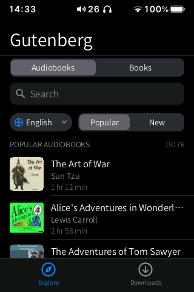
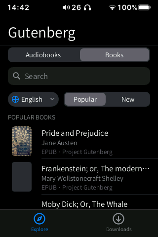
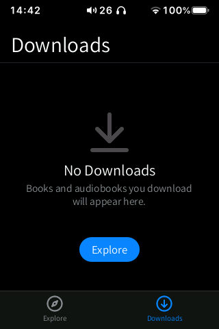

# Gutenberg

Free public-domain books from **Project Gutenberg** and free audiobooks from **LibriVox**, to
search, download, read and listen to on the HiBy R3 II.

  
  
  
  

## What it is

Gutenberg uses the same engine as [Books](../books/README.md), opened straight on its
catalogs. Books already has an **Explore** tab with the same sources (and any OPDS catalog you
add), so Gutenberg is a shortcut and a fallback: if something goes wrong in Books' Explore
tab, you can still find and download books here.

Everything you download is shared with Books:
- e-books (EPUB) go to the **Books** folder of the SD card and appear in Books' **Library**;
- audiobooks go to the **Audiobooks** folder and appear in Books' **Audiobooks** tab.

## How to use

1. Open **Gutenberg** on the home screen. You need Wi-Fi.
2. At the top, choose **Audiobooks** or **Books**.
3. Pick the language and **Popular** or **New**, or tap the search field and type a title or
   an author.
4. Tap a title to open its page, then **Download**. A progress ring shows the download; you
   can leave the page and keep browsing.
5. **Downloads** lists what you have downloaded. Tap a book to read it, or an audiobook to
   play it.

Gestures are the system ones: swipe in from either edge to go back, and up from the bottom
bar to go home.

## Install and uninstall

Gutenberg comes preinstalled. It is listed in **Apps** under "Included with ByOS", so you
can uninstall it (long-press its icon › **Uninstall**, or from **Apps**) and reinstall it
from the same place. Uninstalling it does not delete the books or audiobooks you downloaded.

## Sources and licences

- [Project Gutenberg](https://www.gutenberg.org): public-domain e-books (OPDS catalog).
- [LibriVox](https://librivox.org): public-domain audiobooks read by volunteers, served from
  the Internet Archive.

Both are free and need no account. Check the public-domain status for your country before
sharing a downloaded file.
