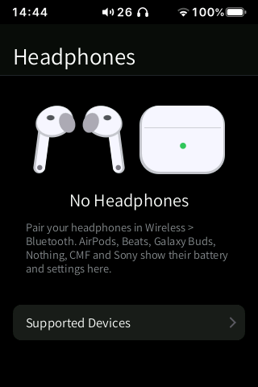
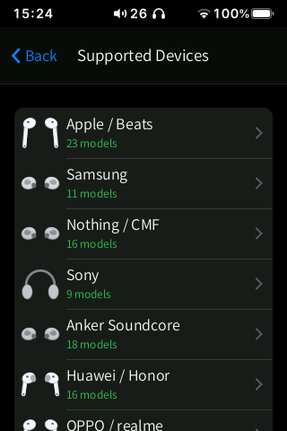
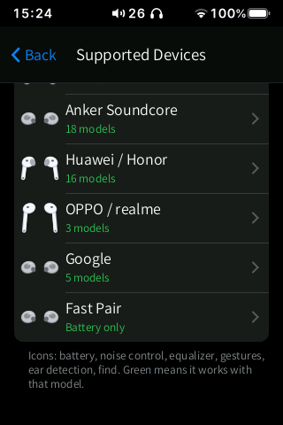
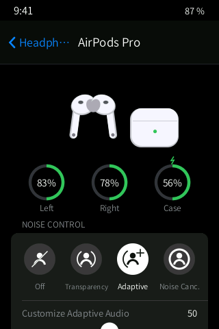
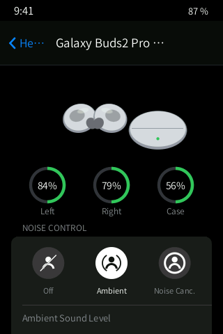
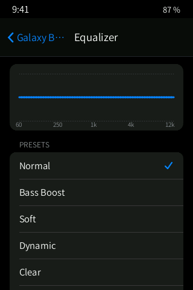
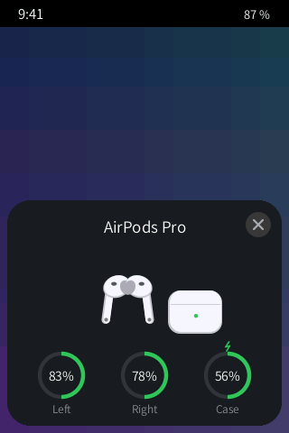

# Headphones (in development)

> **In development.** This app is not part of a release and has no home screen icon yet. It
> builds and its tests pass on the PC and in the QEMU harness against **simulated**
> headphones, but it has **never been run with real headphones**. Everything below describes
> the code as it is now; protocol details marked as inferred in `docs/HEADPHONES.md` still
> have to be confirmed with captures.

**Native control of Bluetooth headphones on the HiBy: battery of each bud and the case, wear
detection with auto-pause, noise control, EQ, gestures, touch lock, find, rename and firmware
info, for AirPods / Beats, Galaxy Buds, Nothing / CMF, Sony (read-only for now) and any
Google Fast Pair headset (battery).**

  
  
  

PC renders of the per-model pages with simulated headphones (`tests/buds_render.sh`):

  
  
  
  

*These images are PC renders of the app's real drawing code with simulated headphones
(`tests/buds_render.sh`), not photos of the device. The status bar values are placeholders.*

## Planned and implemented features

Implemented in the code (not yet verified with real headphones):

- **Headphones list**: connected first, battery line (left / right / case), spinner while
  connecting, and a **Supported Devices** page listing every model by brand with its features.
- **Device page**: a drawing of the product; battery rings for left, right and case (or one
  ring for headphones), grey when disconnected, a bolt when charging, red at 20 % or less.
- **Noise control**: a segmented control with only the modes the model has (Off, ANC,
  Transparency / Ambient, Adaptive) and the level slider of the selected mode; conversation
  awareness / voice focus where available.
- **Press-and-hold cycle** (Apple) or **Gestures** per side and per gesture with an action
  picker (Samsung, Nothing).
- **Equalizer**: presets with a curve picture; 3-band custom EQ on Nothing; bass boost.
- Low latency, ear detection, **Pause when removed** (auto-pause and resume when a bud leaves
  and returns to the ear, for models that report wear), touch lock, ear-tip fit test.
- **Find** (two big buttons, with a loud-sound warning first), **Name** (rename), **About**
  (model, model number, firmware, serial, address), Connect / Disconnect.
- **Connection card**: when headphones connect, a card slides up from the bottom with their
  batteries (shown once per connection, not for short reconnect blips).
- **Batteries widget**: when headphones are connected, the widget shows the HiBy plus the
  headphones (small) or the HiBy plus left / right / case (medium).

| Brand | What is supported |
|---|---|
| Apple / Beats | battery L/R/case, ear detection, noise control and adaptive level on models that have them, press-and-hold cycle. Features that need an Apple host (hearing health, transparency customisation) are listed as unavailable |
| Samsung Galaxy Buds | battery, wear, noise control (and levels on Pro), EQ presets, touch lock, touch-and-hold action per side, find |
| Nothing / CMF | battery, noise modes and ANC level, EQ presets, custom and advanced EQ, Ultra Bass, in-ear detection, low latency, gestures, find, fit test |
| Sony (WH/WF-1000XM3 to XM6, LinkBuds) | read-only for now: battery, ambient sound control and EQ are shown but not changed until captures confirm the protocol |
| Any Google Fast Pair headset | battery, model and firmware (read-only) |

The full per-model matrix is generated from the code: `docs/HEADPHONES.md` §7.

Planned next: launcher icon and Control Centre card, captures from real headphones to confirm
the layouts (Galaxy Buds generations, AirPods press-and-hold per side, Nothing gestures), JBL
support. From the research in `docs/research_codecs_earbuds.md` (not started): an AirPods
"lid open" popup through a low-duty BLE scanner, battery for generic headsets through HFP,
better AAC encoding (the codec AirPods and Galaxy Buds use with non-Samsung sources) and a
picker that shows or chooses the active Bluetooth codec. New Bluetooth codecs are not
planned: the R3 II already sends SBC, AAC, aptX, aptX HD, LDAC and HiBy UAT, and the others
are proprietary or need newer Bluetooth hardware.

## How it will be used

1. Pair the headphones in [Wireless](../wireless/README.md) › Bluetooth.
2. When they connect, the connection card appears with their batteries; tap it to open the
   app.
3. Open a device to change noise control, EQ and gestures. Changes show at once; if the
   headphones refuse one, it slides back with a short notice.

The app uses the standard gestures: back from either edge, swipe up from the bottom bar to go
home, swipe up and hold still for 1 s for multitasking.

## Limitations / known issues

- Not tested with real headphones; not in the launcher yet.
- Sony is read-only until captures exist; JBL is not implemented (JBL with Fast Pair get
  battery only).
- Apple-host-only features need a Bluetooth Device ID spoof, which is not implemented.
- Not implemented: AirPods "find" (not part of the protocol over classic Bluetooth), per-side
  press-and-hold actions for AirPods, Galaxy game mode and 360 audio.
- Same open question as Wireless: whether the player switches its audio output after a
  connection started by HiByOS.

## Technical notes

| | |
|---|---|
| Source | `src/buds.inc.c` (app, reader thread, API for the CC card, popup and widget), `src/buds_core.inc.c` (shared state and command formats), brand modules `src/buds_apple.inc.c`, `buds_samsung.inc.c`, `buds_nothing.inc.c`, `buds_sony.inc.c`, `buds_fastpair.inc.c`, registry `src/buds_all.inc.c`, simulator `src/buds_sim.inc.c`, texts `src/lang/buds_tr.inc.c` |
| Daemon | `hibybudsd` (`src/hibybudsd.c`, static, ~165 KB): watches BlueZ through `dbus-monitor`, opens the vendor channel on the existing connection (L2CAP for Apple, RFCOMM for the others, channel found by its own SDP client), writes `/tmp/hibybuds.state` and reads commands from the FIFO `/tmp/hibybuds.cmd` |
| Data | known channels `/usr/data/hibymod/buds/known.txt`; per-device preferences `/usr/data/hibymod/buds/shell.conf` |
| Bluetooth use | **no inquiry, scan or discovery, ever** (to avoid A2DP stutter); a few packets per user action on the existing link; reconnect backoff from 2 s to 5 min |
| Tests | `tests/buds_test.sh` (protocol checks, fake daemon end to end, the doc matrix, 13 languages), `tests/buds_render.sh` (PNG renders), `tests/buds_vm/*.cmds` (QEMU harness) |

More: `docs/HEADPHONES.md`, `docs/research_headphones_nothing_sony_jbl.md`,
`docs/research_codecs_earbuds.md`.

## Links

- [All apps](../README.md)
- [Wireless](../wireless/README.md)
