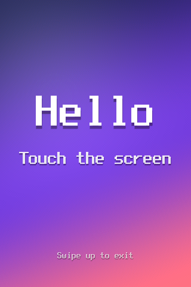
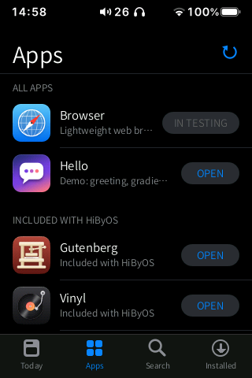

# Hello (`hola`): the example app

**The smallest complete external app for HiByOS, for developers: a dithered gradient, a
greeting in the interface language, and a circle that follows your finger. Use it as the
template for your own `.hpk` app.** "Hola" is Spanish for "hello"; the package id is
`org.hibymod.hola` and its name is shown as Hello / Hola / Bonjour.

<p align="center">
  
  
</p>

Status: **Stable (example)**. It is published in the HiByOS repository (release `apps-1`) and
can be installed from the **Apps** store.

## Features

- Full-screen diagonal gradient with 4×4 ordered dithering (no banding in RGB565) and a soft
  glow.
- "Hello" / "Touch the screen" / "Swipe up to exit" in the shell's language (`HM_LANG`:
  Spanish, English or French), drawn with an upscaled 8×16 bitmap font.
- A circle that appears with a spring when you touch, follows your finger and fades out when
  you lift it.
- Uses no CPU while idle (it waits up to 1 s for input when nothing animates) and exits
  cleanly on `SIGTERM`.

## How to use

1. Open **Apps**, find **Hello** and tap **GET** (choose the SD card or the HiBy), or copy
   `out/apps/hola.hpk` to `SD/Apps/` and install it from **Apps › Apps › On the SD card**.
2. Tap **OPEN** or its icon on the home screen.
3. Touch and drag on the screen.
4. Swipe up from the bottom bar to close it.

## For developers

### Files

| File | What it is |
|---|---|
| `hola.c` | the app (about 140 lines): `hm_app_init`, framebuffer, touch, a RAM canvas presented with `hm_fb_present` |
| `manifest.ini` | the package manifest (see below) |
| `icon.png` | 128×128 full-bleed square icon; the installer adds the rounded mask, gloss and border |
| `mkicon.py` | draws `icon.png` (Pillow) |
| `font8x16.h`, `mkfont.py` | the bitmap font and the script that generates it |

### Manifest

```ini
id=org.hibymod.hola
version=1.0.0
min_hibymod=0.1.0
name=Hola
name.en=Hello
name.fr=Bonjour
description=Demo: saludo, degradado y un círculo que sigue al dedo
description.en=Demo: greeting, gradient and a circle that follows your finger
description.fr=Démo : salutation, dégradé et un cercle qui suit le doigt
exec=bin/hola
arch=mipsel-hf
input=touch
stop_player=0
ram_kb=900
category=demo
author=hibymod
```

`name` and `description` without a suffix are the Spanish fallback; `.en` and `.fr` are the
translations. All keys: `docs/APP_FORMAT.md` §2.

### Build and package

```sh
bash tools/wsl/zbuild_app.sh hola     # WSL: compiles apps/hola/*.c and writes out/apps/hola.hpk
python tools/hpk.py verify out/apps/hola.hpk
python tools/hpk.py inspect out/apps/hola.hpk
```

The script compiles with Zig's C compiler for `mipsel-linux-musleabihf`, `-mcpu=mips32r2
-Os -static`, with the SDK in `src/sdk/`, then packages `manifest.ini`, `icon.png`, `data/` (if
present) and `bin/hola` with `tools/hpk.py build`.

### The rules your app must follow (summary of `docs/APP_FORMAT.md`)

- **Static, hard-float MIPS32r2 little-endian ELF** (`arch=mipsel-hf`); no shared libraries.
- **Screen**: 320×480 RGB565, double buffer with panning. Draw the whole hidden buffer, then
  pan (`hm_fb_present` does it); never write to the buffer being shown. About 44 fps at most.
- **Touch** comes from the virtual touchscreen in `HM_TOUCH` (fed by the shell, which also
  watches for the swipe up from the bottom bar that closes the app); keys from `HM_KEYS`.
- **Exit within 1 s of `SIGTERM`** (sent when the user swipes up from the bottom bar);
  `SIGKILL` follows. Leave no child processes.
- **Memory**: there is no swap and running out of memory freezes the device. With
  `stop_player=0` stay within a few MB and declare `ram_kb` honestly; large apps must watch
  `MemAvailable` and exit early with code 99 (the shell then says the app closed for lack of
  memory). Never write large files to `/tmp` (it is RAM).
- **Data**: write only to `HM_DATA_DIR` (`/usr/data/hibymod/appdata/<id>`, kept across updates).
  `HM_APP_DIR` is the install folder (on the HiBy or the SD card), read-only by convention.

### SDK (`src/sdk/hm_app.h`, header only)

`hm_app_init()`, `hm_fb_open / hm_fb_present / hm_fb_close`, `hm_touch_open / hm_touch_read`
(`HM_DOWN / HM_MOVE / HM_UP`), `hm_keys_open / hm_keys_read`, `hm_wait(t, k, ms)`, `hm_lang()`,
`hm_tr(es, en, fr)`, `hm_app_dir()`, `hm_data_dir()`, `hm_now_ms()`.

### Publishing

Add your package to a repository `index.json` (format in `docs/STORE.md` §2) with its size and
SHA-256; `tools/mkrepo.py` generates the HiByOS one. Users add your repository in
**Apps › Installed › Add Repository…**.

### Testing without the device

The QEMU harness (`docs/VM_SHELL.md`) stages `out/apps/hola.hpk` on the virtual SD card, so you
can install and open your app in the real shell, take screenshots and measure frame times.
The screenshots on this page were taken there.

## Limitations / known issues

- Only Spanish, English and French texts. `hm_tr()` in the SDK falls back to **Spanish** for
  the other ten interface languages (for example German or Japanese); for an English fallback,
  check `HM_LANG` yourself.
- In the QEMU harness, after the app exits the screen keeps showing its last frame until the
  shell is restarted (the harness's display stand-in does not pan back); to be checked on the
  device.

## Links

- [All apps](../README.md)
- [Apps store](../store/README.md)
- `docs/APP_FORMAT.md` (package format and execution contract), `docs/STORE.md` (repositories)
