# Music

**An Apple Music-style library for the HiBy R3 II: albums, artists, songs, genres, playlists
and mixes, with its own Now Playing screen, synced lyrics, cover and lyrics search, and a tag
editor.**

  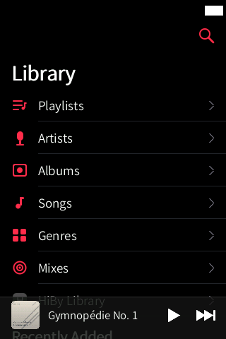
  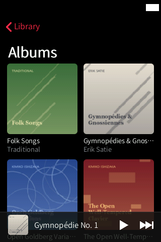
  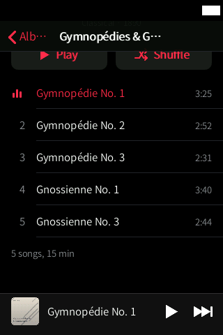
  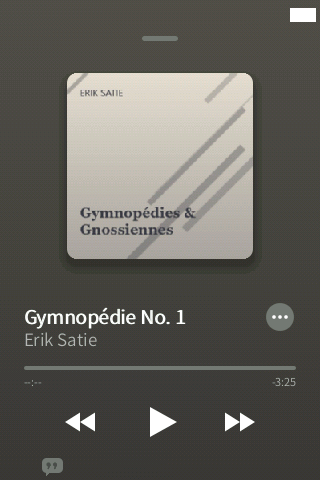
  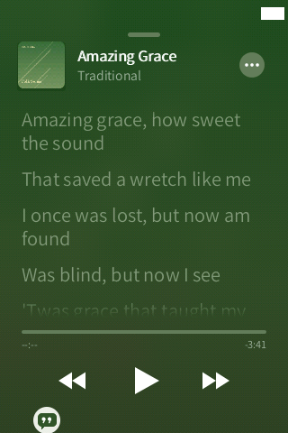

Status: **Beta**. The library, album pages and search are in daily use; some newer parts
(starting playback at a given song, mixes on the device, the new Now Playing) are still being
verified on the device. See [Limitations](#limitations--known-issues).

## Features

- **Library** (dark theme, Apple Music pink): Playlists, Artists, Albums, Songs, Genres,
  Mixes and **HiBy Library** (the stock library, as a fallback), with **Recently Added** in a
  cover grid below.
- **Albums** in a two-column cover grid; **album page** with a large cover, title, artist,
  genre and year, **Play** / **Shuffle**, the track list with durations, and the total.
- **Artists** with their albums, **Songs** with Play / Shuffle, **Genres**.
- **Search** while you type (albums, artists and songs), with the HiByOS keyboard.
- **Playlists**: Favourites (the stock player's favourites) and the player's playlists and
  `.m3u` lists.
- **Mixes**, generated on demand from your listening history: *Daily Mix*, *Discover*
  (artists you haven't played lately), *Your Favorites*, *New Arrivals* and *Your Decade*,
  plus **Create Station** (a 45-track radio seeded by a song or an artist).
- **Context menu** (long-press a song or an album), in the iOS style with a blurred
  background: Play, Create Station, Go to Album, Go to Artist, Edit Song, Edit Album, Find
  lyrics, Find artwork. You can choose an item without lifting your finger.
- **Mini player** at the bottom; tap it or drag it up to open **Now Playing**.
- **Now Playing**: large cover with shadow (it shrinks when paused), background taken from the
  cover, title, artist, progress with elapsed / remaining time, previous / play-pause / next,
  and the **⋯** menu (Create Station, Go to Album, Go to Artist, Edit Song, Edit Album, Find
  lyrics, Find artwork).
- **Synced lyrics** (the speech-bubble button): `.lrc` lyrics next to the song, highlighted
  line by line. **Find lyrics** searches LRCLIB; **Change lyrics** picks another result;
  **Adjust timing** shifts the lyrics with a slider and saves the offset in the `.lrc`.
- **Find artwork**: iTunes and MusicBrainz / Cover Art Archive results, or an image from the
  SD card; apply it to **this song only** or to **the whole album**.
- **Tag editor** for one song or a whole album: the 8 usual tags, **More Tags** (every other
  tag in the file, with readable names, and *Add Field*), multi-line editor for lyrics and
  comments, file renaming with a pattern (album), and autocomplete from your library.

  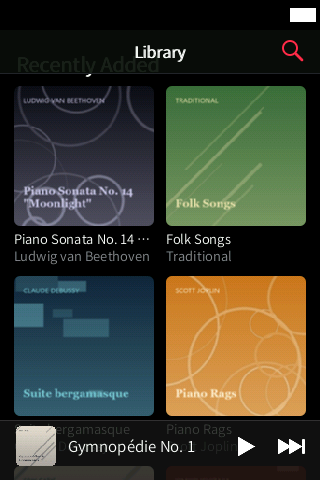
  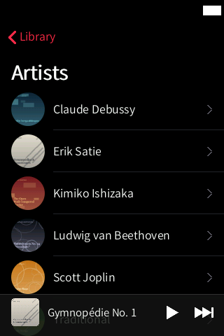
  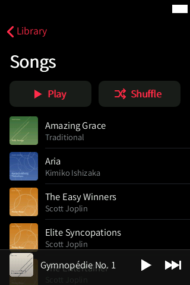
  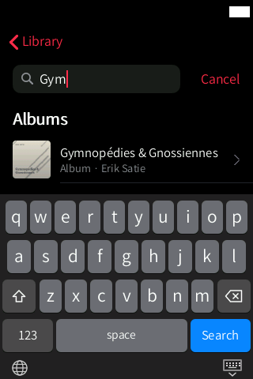
  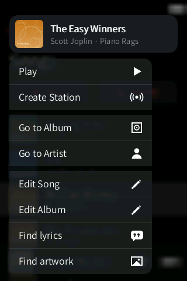

  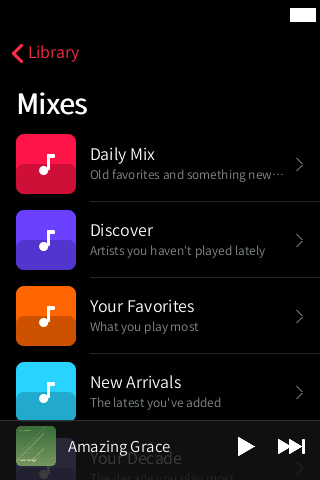
  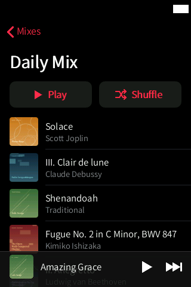
  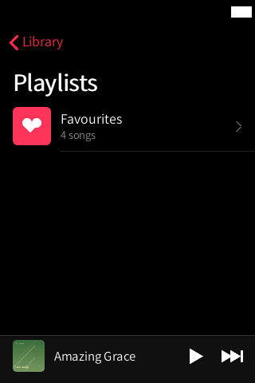
  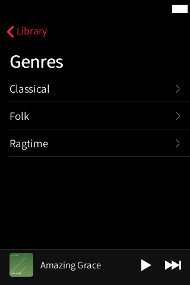
  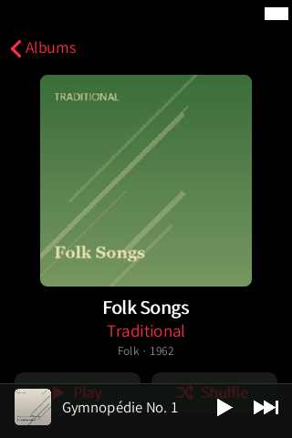

  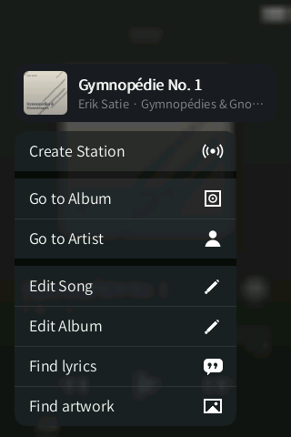
  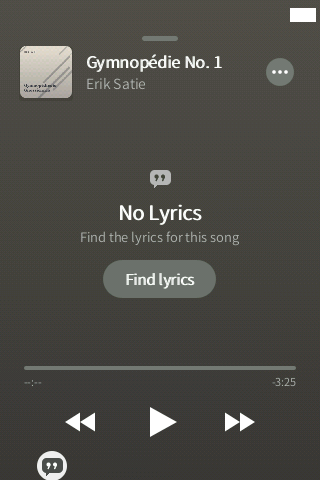
  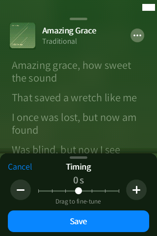
  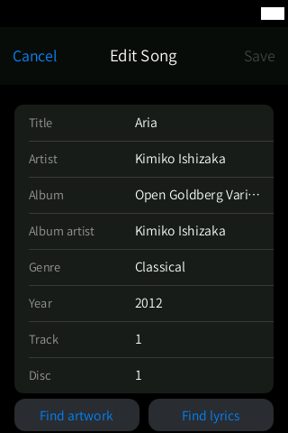
  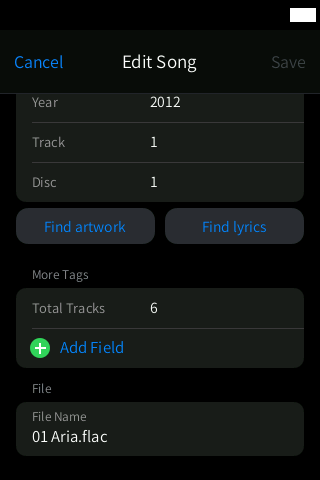

## How to use

1. Open **Music** from the dock (pink icon). The **Now Playing** icon on the home screen opens
   the player directly.
2. Tap **Albums**, **Artists**, **Songs** or **Genres**. Scroll with your finger (iOS inertia
   and bounce).
3. Tap an album, then **Play** or **Shuffle**, or tap a track to play the album from it.
4. **Search**: tap the magnifying glass at the top right of the Library and type. Tap
   **Cancel** to close the keyboard.
5. **Long-press** a song or album for the context menu. Slide to an item and let go, or tap it.
6. **Now Playing**: tap or drag up the mini player. Drag the sheet down to close it.
   - lyrics: tap the speech-bubble button at the bottom left;
   - more options: the **⋯** button next to the title.
7. **Mixes**: Library › Mixes, then a mix to generate and open it.
8. **Edit tags**: long-press a song › **Edit Song** (or an album › **Edit Album**), change the
   fields and tap **Save**. **Cancel** discards the changes.

System gestures work everywhere in the app:

- **back**: swipe in from the left or the right edge (a bubble follows your finger);
- **home**: swipe up from the bottom bar;
- **multitasking**: swipe up from the bottom bar and hold still for 1 s.

## Settings and options

- **Settings › Music Library**: counts (songs, albums, artists), *Find New Music
  Automatically* (the player rescans when the SD card changes), and *Library on the SD card*
  (database and cover cache on the SD card).
- The mixes' names follow the interface language.
- Lyrics timing: per song, saved as `[offset:]` in its `.lrc`.

## Tips

- New files appear after the HiBy rescans the SD card (stock setting: update media library,
  or turn on *Find New Music Automatically*). Music reads the player's own database.
- Put a `cover.jpg` (or `folder.jpg` / `front.jpg`) in each album folder if your files have no
  embedded cover; Music uses either. For the stock player, embed the cover (Find artwork does
  it for you, in FLAC, MP3 and M4A).
- Find lyrics works best with correct artist and title tags; fix them first with the tag
  editor.

## Limitations / known issues

- **No seeking and no "play next"**: the stock player offers no API for them, so the progress
  bar cannot be dragged and the menu has no such entry.
- **Starting playback at a given song** uses the display library v6 (`docs/research_play_list.md`);
  it is new and still being verified on the device.
- **Mixes**: generation works off the device; on the device the lists were not generated in
  one test (open item in `todo.md`). Mixes and stations are written as `.m3u` lists, which the
  stock player's own UI does not show.
- The library is read-only (it is the player's database); new music needs a rescan by the
  player.
- Cover and lyrics search need Wi-Fi.
- In the screenshots (QEMU harness) the track is paused with no elapsed time because there is
  no real player.

## Technical notes

| | |
|---|---|
| Source | `src/music.inc.c` (library, lists, search, covers), `src/nowui.inc.c` (Now Playing, context menu), `src/lrc_core.inc.c` (LRC parser), `src/lyrics.inc.c` (lyrics and cover search), `src/tageditor.inc.c` (tag editor), `src/nowplaying.inc.c` (what is playing), `src/playctl.inc.c` (play / pause / lists) |
| Helpers | `hibymix` (`src/hibymix.c`: read-only library queries `lib`, `playlists`, `playlist`, and the mixes `make` / `radio`), `hibytag` (`src/hibytag.c`: tag reading/writing, cover embedding, library database updates), `hibynet` (`src/hibynet.c`: LRCLIB, iTunes, MusicBrainz / Cover Art Archive), `hibywall` (image decoding to RGB565) |
| Data read | the player's database `/usr/data/usrlocal_media.db` (SQLite, through `hibymix` in a separate process, read-only) |
| Cache | `SD/HiByOS/cache/music/` (library snapshot `lib.tsv`, covers at 48, 140 and 232 px, capped at 48 MB); rebuilt when the database changes |
| Written | lyrics: `<song>.lrc` next to the audio file (UTF-8 with BOM); covers: `cover.jpg` in the album folder and embedded in the files; mixes: `SD/Mezclas/<name>.m3u` plus a row in the player's list table |
| Network | only when you search for lyrics or covers (LRCLIB, iTunes Search, MusicBrainz, Cover Art Archive). No account, no tracking; the User-Agent identifies HiByOS |
| Performance | nothing is allocated per frame; only the visible strip is drawn; covers are decoded in a low-priority thread, never on the UI thread |

More: `docs/LYRICS_AND_COVERS.md`, `docs/research_play_list.md`, `docs/research_playback.md`,
`docs/research_seek_queue_volume.md`.

## Links

- [All apps](../README.md)
- [Files](../files/README.md) (also opens the tag editor for audio files)
- [Settings › Music Library](../settings/README.md)
- [Free Music](../freemusic/README.md) (downloads into `Music/Free`)
