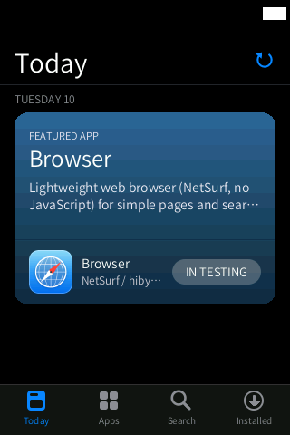
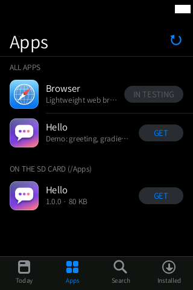

# Browser (`navegador`)

> **Experimental, and blocked.** The Browser is listed in the store as **IN TESTING**: it
> cannot be installed, and the shell refuses to open it even if it is installed. Please do
> not side-load it onto your HiBy.

**A lightweight web browser for simple pages and searches, based on NetSurf 3.11 (no
JavaScript), packaged as an external `.hpk` app.** "Navegador" is Spanish for "browser"; the
folder keeps that name because it is the app's package id (`org.hibymod.navegador`).

<p align="center">
  
  
</p>

There are no screenshots of the browser itself on purpose: it is not run on the device (see
below), and these pages only show how the store presents it.

## Why it is blocked

The first test on the device, with the player running (about 7.7 MB of available memory),
**froze the HiBy completely** (ADB included) two seconds after opening it. The R3 II has no
swap, and when memory runs out the kernel keeps evicting the code of every process
(*thrashing*) before the out-of-memory killer can act.

Since then the browser was rebuilt to use much less memory (below), and a strict test suite
was run in the QEMU harness with the same memory available as the device with music playing.
The result (2026-11-10): **not reliably usable while the player runs**. Only minimal pages
fit; on larger pages the watchdog closes the app as intended, but multi-second stalls still
happen before it can act. Full numbers: `docs/STORE.md` §6.

It will not be opened on the device again until the off-device suite passes all four
criteria: the player never dies, the watchdog kills the browser on every page that does not
fit, no stall longer than 1.5 s, and light pages load and scroll.

Ways forward being considered:

1. open it only with the player stopped (needs a shell hook to stop and restart `hiby_player`);
2. replace it with a small reading viewer backed by a proxy on a computer, under 2 MB;
3. trim NetSurf further (smaller CSS/HTML libraries, fewer image formats); not enough alone.

## What it does (when it runs)

- Renders simple HTML/CSS pages with NetSurf's framebuffer front end: no JavaScript, no
  background images, no animations.
- Touch scrolling 1:1 with iOS inertia, at pixel level.
- Closes with the usual swipe up from the bottom bar (`SIGTERM`).
- Pauses the music when it opens (`stop_player=1`) to get memory, and keeps the panel at full
  refresh while open (`refresh=full`).

## Files in this folder

| File | What it is |
|---|---|
| `navegador.c` | the launcher: sets `oom_score_adj=1000` for NetSurf, caps its address space (`RLIMIT_AS` = initial size + available RAM − margin), and runs a `MemAvailable` watchdog every 50 ms (locked in memory, real-time priority) that kills NetSurf below 2.8 MB and exits with code 99, so the shell shows "The app closed: not enough memory" |
| `manifest.ini` | package manifest (`id=org.hibymod.navegador`, `stop_player=1`, `refresh=full`, `ram_kb=7000`) |
| `build.sh` | builds the launcher and packages it with NetSurf and its resources into `out/apps/navegador.hpk` |
| `ca.pem` | reduced CA bundle (41 roots, saves about 0.8 MB of memory) |
| `icon.png`, `mkicon.py` | the app icon and the script that draws it |

NetSurf itself is built by `apps/netsurf-hiby/build/build_hf.sh` (hard-float NetSurf 3.11 and
its dependencies: zlib, mbedTLS, curl, libpng, libjpeg, expat), with the custom HiBy backend
`apps/netsurf-hiby/build/nsfb_hiby.c` (RAM canvas, full-buffer copy then pan, touch from
`HM_TOUCH`, `SIGTERM` exits) and the scrolling patch `patch_gui.py`. The tuned options
described in `docs/STORE.md` §6 are a 384 KB memory cache, no disk cache, 2 connections and no
JavaScript (note: the older `apps/netsurf-hiby/Choices` file in the repository still has a
1 MB cache and 3 fetchers).

## Building (developers)

```sh
bash apps/netsurf-hiby/build/build_hf.sh     # NetSurf hard-float (WSL)
bash apps/navegador/build.sh                 # -> out/apps/navegador.hpk
```

Test only in the QEMU harness, following the protocol in `docs/STORE.md` §6 (memory profile
`coexist` + `memhog 2`, the page suite and the four criteria above). The suite script
`scripts/navt2.cmds` and `share/nsm.sh` named there live in the harness copy (`~/hiby/vm`),
not in this repository.

## Limitations / known issues

- Blocked: `"available": false` in `repo/index.json` (no package is published) and the id is
  in `app_blocked_ids[]` in `src/store.inc.c`.
- No JavaScript, so many modern sites will not work even when memory allows.

## Links

- [All apps](../README.md)
- [Apps store](../store/README.md)
- `docs/STORE.md` §6 (test protocol and results), `docs/research_apps_vm.md`
- NetSurf: <https://www.netsurf-browser.org>
