# Settings

**The HiByOS settings app, with grouped lists in the iOS style. It replaces HiBy's System
settings and its "USB DAC" app: the player's sound and system options, USB, the home screen,
gestures, the Control Centre, the keyboard and developer tools, all in one place.**

  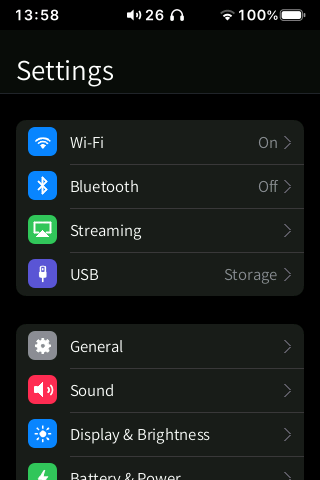
  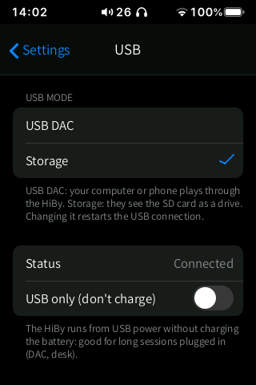
  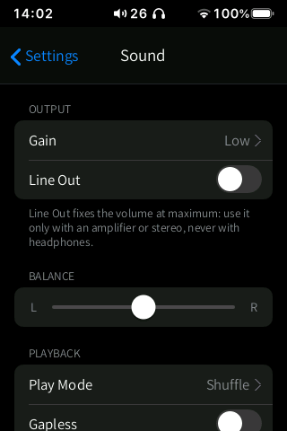
  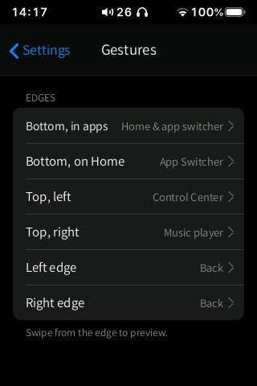
  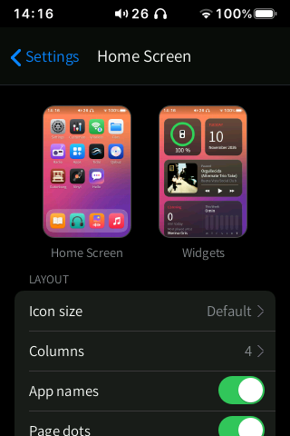

Status: **Beta**. The HiByOS pages (home screen, gestures, Control Centre, keyboard,
developer, power modes, DAC filters) are in use on the device. The pages that change the
**player's own settings** use a new API of the display library (v7, command `S`) that has not
been tested on the device yet (`docs/research_settings_api.md` §7).

## Features

Open **Settings** on the home screen (grey gear). The old **Customize** app is now the
**Personalization** section of Settings: Home Screen, Control Center, Gestures and Keyboard.

| Group | Page | What is in it |
|---|---|---|
| Connections | **Wi-Fi**, **Bluetooth** | shortcuts to the [Wireless](../wireless/README.md) pages, with the current state |
| | **Streaming** | AirPlay and DLNA (need Wi-Fi), HiBy Link (control from the HiBy Music phone app) |
| | **USB** | USB mode: **USB DAC** (a computer or phone plays through the HiBy) or **Storage** (they see the SD card as a drive); connection status; **USB only (don't charge)** |
| System | **General** | Info (model, HiByOS version, songs, albums, installed apps, storage, free memory, project link), Software Update, Date & Time, Language (13 languages or "same as the system"), auto power-off (Sleep Timer, When Idle) |
| | **Display & Brightness** | brightness slider, Auto-Lock (screen-off time; music keeps playing) |
| | **Sound** | Gain, Line Out (with a confirmation), Balance, Play Mode (in order, repeat song, repeat list, shuffle), Gapless, Crossfade (one turns the other off), ES9219 DAC **Digital filter** (8 filters), MSEB, EU high-volume warning, Reset sound settings |
| | **Battery & power** | Power mode: **Low Power** (30 Hz panel, brightness capped at 40 %), **Normal** (45 Hz, like HiBy's firmware), **Performance** (fastest panel rate); USB only (don't charge) |
| HiByOS | **Music Library** | counts, *Find New Music Automatically*, *Library on the SD card* and *Cover cache on the SD card* (reboot to apply) |
| | **Home Screen** | live preview, icon size, columns, app names, page dots, dock background, dim the wallpaper, wallpaper (images from `SD/Pictures`), widgets page, reset the home screen |
| | **Gestures** | the action of each edge (bottom in apps, bottom on the home screen, top-left, top-right, left edge, right edge) with an animated preview: swipe from the edge on the page to see it |
| | **Control Center** | which controls appear, in two groups: Airplane Mode, Noise Control, Bluetooth, Wi-Fi, USB only, Power mode; then USB DAC, Digital filter, Files, Settings |
| | **Keyboard** | height (Compact, Normal, Tall), number row, layout (English QWERTY, Spanish QWERTY, French AZERTY) |
| | **Developer** | ADB: Off, Wi-Fi (shows the address to `adb connect`) or USB |

  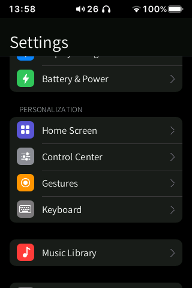
  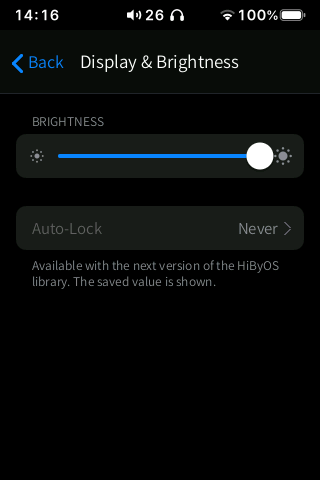
  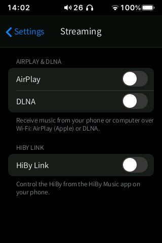
  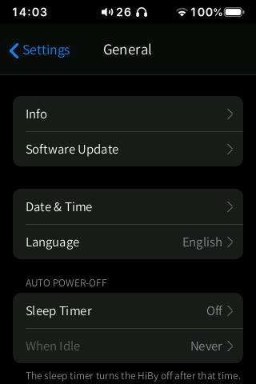
  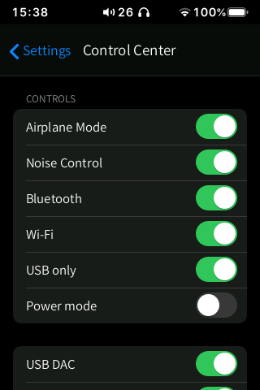

  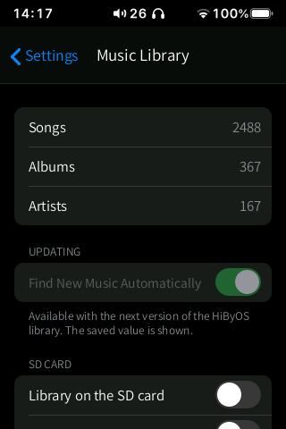
  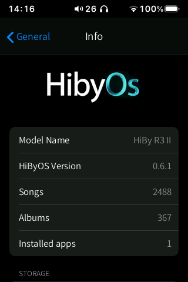
  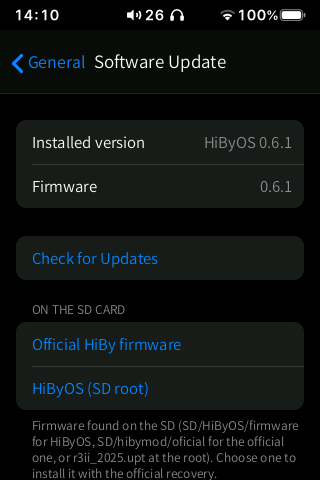
  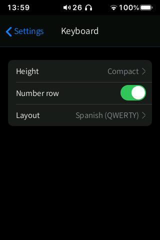
  

## How to use

1. Open **Settings** and tap a row to open its page (iOS push transition).
2. Toggles and choices apply at once. A change that the player refuses slides back, with a
   short notice.
3. Go back with **‹ Settings** or by swiping in from the left or right edge.
4. USB mode, Line Out and the EU volume warning ask for confirmation first.
5. Gestures: on the Gestures page, tap an edge to choose its action, and swipe from that edge
   to watch the preview.

System gestures: back from either edge; swipe up from the bottom bar to go home; swipe up and
hold still for 1 s for multitasking.

## Settings and options

Everything above. HiByOS's own settings are saved in `/usr/data/hibymod/` (for example
`shell/launcher.conf` for the home screen and gestures); the player's settings are saved by
the player in `/usr/data/user.ini`, exactly as when you change them in HiBy's own screens.

## Tips

- **USB only (don't charge)** is handy for long sessions as a desk DAC: the HiBy runs from USB
  power and the battery is spared. It is also a Control Centre button.
- The 8 DAC filters need HiByOS 0.5.4 or later (patched DAC driver); with the stock driver
  only 2 are available, and the page says so.
- *Library on the SD card* makes big libraries faster and saves wear on the internal memory;
  it needs a reboot and a library rescan.
- Keep **ADB** off when you don't use it.

## Limitations / known issues

- The player's settings (Sound, Display, Battery, USB) are read from and written to the
  stock player through its settings API (v7), as in the screenshots above. If the player does
  not answer, the pages show the saved values greyed out with the notice "The player's
  settings are not responding".
- Brightness, screen-off, idle power-off and the library update mode are new keys proposed for
  the next library version; until it knows them they are shown greyed out with the saved
  value (`docs/research_settings_api.md` §9).
- Going back to the official firmware from Software Update has not been tested; the page
  warns before starting.
- Performance power mode: the help text says 60 Hz, while `todo.md` records 48.7 Hz as the
  highest rate within the panel's specification (to be confirmed).

## Technical notes

| | |
|---|---|
| Source | `src/settings_app.inc.c` (app frame and HiByOS pages), `src/sysset.inc.c` (system, sound, USB, library and about pages), `src/hibyset.inc.c` (player settings API client), `src/settings.inc.c` (home screen settings and wallpaper picker), `src/ota.inc.c` (software update), `src/power.inc.c` (power modes), `src/lang/settings_tr.inc.c` |
| Player settings | requests go to `hibymod_disp.so` v7 inside the player (command `S` on `/tmp/hibymod_disp`, request/response files in `/tmp`). One request at a time, at most 4 writes per second (each one rewrites `user.ini` in flash); several changes of the same slider are merged. The UI never waits for the player: values are read from `/usr/data/user.ini` first and refreshed in the background |
| Helpers | `hibysetctl` (command-line client of the same API), `hibywall` (wallpaper thumbnails) |
| Software update | looks for `SD/HiByOS/firmware/*.upt` (HiByOS) and `SD/hibymod/oficial/*.upt` (official) and uses the official recovery; `/usr/data` is kept |
| Network | none (Info shows the project's GitHub address as text) |

More: `docs/research_settings_api.md`, `docs/research_overclock_power.md`,
`docs/research_hidden_firmware.md`.

## Links

- [All apps](../README.md)
- [Wireless](../wireless/README.md)
- [Main README: install, update and recovery](../../README.md)
