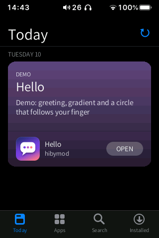
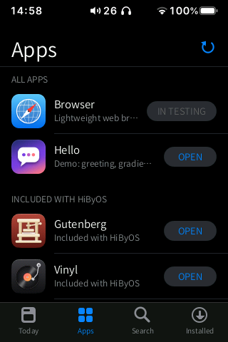
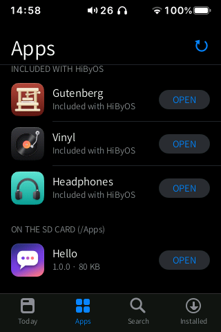
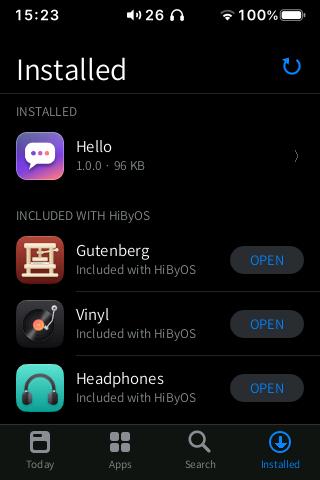
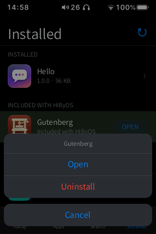
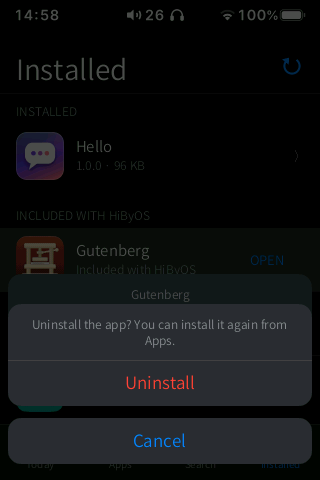

# Apps (store)

**A light App Store for HiByOS: install apps from online repositories or from `.hpk` files on
the SD card, choose to install them on the SD card or on the HiBy, and open, move, back up or
uninstall them.**

  
  
  
  
  

Status: **Beta**. The `.hpk` installer and the management of installed apps (open, back up,
uninstall, erase data) are done and used; the repositories, the SD card installs and moving
apps are newer. The screenshots show the real HiByOS repository, fetched live from GitHub.

## Features

- **Tabs** at the bottom (they switch on touch-down, as in iOS):
  - **Today**: large cards with the featured apps;
  - **Apps**: every app from the repositories with icon, name, description and button, and
    below them the packages found on the SD card (`/Apps/*.hpk`);
  - **Search**: filters by name and description (any case, with or without accents);
  - **Installed**: your apps with version and location (HiBy or SD card), UPDATE when a new
    version exists (the tab shows a red badge with the count), and the **repositories**.
- **App page** (slides in from the right): 96 px icon, name, author, **GET / UPDATE / OPEN**,
  size, version and memory, description, a notice if the app pauses the music, and
  repository, category and identifier.
- **GET**: if there is an SD card it asks where to install, then the button becomes the iOS
  progress ring (tap it to cancel). The download is checked (size and SHA-256), installed
  atomically, and the app appears on the last home screen page.
- **Install on the SD card or on the HiBy**: "On the SD card (… free)" or "On the HiBy (… free)".
  The HiBy has only about 24 MB free, so the SD card comes first.
- **Installed app actions** (tap it in Installed): **Open**, **Move to SD card / Move to HiBy**,
  **Back up**, **Uninstall** (keeps its data) and **Uninstall and delete data**.
- **Repositories**: the HiByOS repository (cannot be removed) plus up to 8 of your own; each
  shows its status and number of apps, with **Update now**, **Remove** and **Add Repository…**.
- **Refresh**: pull down on a list, or tap the circular arrow next to the title.

  
  

## How to use

### Install from a repository

1. Connect to Wi-Fi and open **Apps**.
2. Browse **Today** or **Apps**, or **Search**. Tap an app to see its page.
3. Tap **GET**. With an SD card inserted, choose **On the SD card** or **On the HiBy**.
4. Wait for the ring to finish. Tap **OPEN**, or find the new icon on the home screen.

### Install a `.hpk` file

1. Copy the `.hpk` file to the **`Apps/`** folder at the root of the SD card (from a computer,
   or with USB Storage mode).
2. Open **Apps › Apps**: it is listed under **On the SD card (/Apps)**. Tap **GET**.

### Manage installed apps

1. Open the **Installed** tab and tap an app.
2. Choose **Open**, **Move to …**, **Back up**, **Uninstall** or **Uninstall and delete data**.
3. A backup is saved on the SD card as `Apps/Copias/<id>-<version>.hpk` (a reinstallable
   package), plus `Apps/Copias/<id>-datos.tar` with the app's data if it has any. To restore
   it, move the `.hpk` to `Apps/` and install it.

### Add a repository

1. In **Installed**, tap **Add Repository…** and type the URL of its `index.json`.
2. Only add repositories you trust: a repository can publish any program.

### Close an app

Swipe up from the bottom bar. The shell asks the app to quit (and forces it after 1 s).

The store itself has the usual gestures: back from either edge (the app page follows your
finger), swipe up from the tab bar to go home, swipe up and hold still for 1 s for
multitasking. Tap the active tab to scroll back to the top.

## Settings and options

- Repositories (Installed tab). The list is stored in `/usr/data/hibymod/store_repos.conf`, one
  URL per line.

## Tips

- Install apps on the SD card: they run in place (the card is mounted without `noexec`) and
  only a ~30 KB stub stays on the HiBy. Their data always stays on the HiBy.
- If the SD card is missing, apps installed on it show "SD card missing" and cannot be opened
  until you insert it.
- If you leave the store during a download, the download is cancelled.

## Limitations / known issues

- **Browser** is listed as **IN TESTING** and cannot be installed or opened (see
  [navegador/](../navegador/README.md)).
- The backup folder is named `Copias` (Spanish for "copies") on every language.
- An app uninstalled while its SD card is missing leaves the folder `HiByOS/apps/<id>` on the
  card, to delete by hand.
- The home screen icon of an SD app whose card is missing is not dimmed yet.
- Slow response of the store on the device was reported once (open item in `todo.md`); in the
  QEMU harness touch-to-feedback is 11–32 ms.

## Technical notes

| | |
|---|---|
| Source | `src/store.inc.c` (store UI, repositories, downloads, SD installs, backups, running external apps), `src/hpk.inc.c` + `src/hpk.h` (installer; PC tests `tests/hpk_test.c`) |
| Helpers | `hibynet get` (HTTPS with certificate verification, in separate processes) |
| Repository | default `https://raw.githubusercontent.com/Grohle/hibyos/main/repo/index.json`; packages are assets of the GitHub release `apps-1` |
| Cache | `/usr/data/hibymod/cache/store/` (`<hash>.json` indexes, `icons/`, `dl/` while downloading to the HiBy; SD installs download to `SD/HiByOS/dl/`) |
| Install paths | HiBy: `/usr/data/hibymod/apps/<id>/`; SD card: `SD/HiByOS/apps/<id>/` plus a stub in `/usr/data/hibymod/apps/<id>/` (`manifest.ini`, icons, `sd_location`); data: `/usr/data/hibymod/appdata/<id>/` |
| Safety | SHA-256 and size checked before installing; the installer validates the whole tar first and swaps the new version in with two `rename()`s, so a power cut never leaves a half-installed app (`hpk_recover`) |
| Network | only on refresh (pull down / button), once on the very first run, and for downloads. Switching tabs or scrolling never uses the network or the disk |

More: `docs/STORE.md`, `docs/APP_FORMAT.md`.

## Links

- [All apps](../README.md)
- [Hello](../hola/README.md): the example app, and how to make your own
- [Browser](../navegador/README.md)
