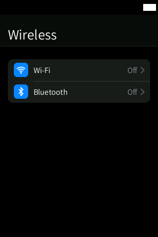
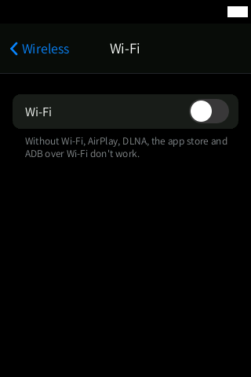
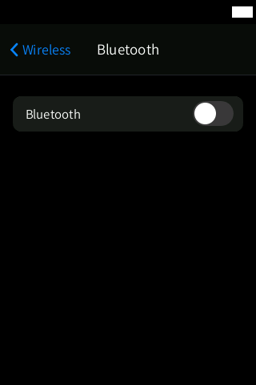

# Wireless

**Wi-Fi and Bluetooth in the style of iOS Settings, replacing HiBy's "Wireless" app: join
networks, see network details, pair and connect Bluetooth devices, and switch AirPlay, DLNA
and HiBy Link.**

  
  
  

Status: **Experimental**. It builds with zero warnings and its PC tests pass, but it **has
not been run on the device yet**. The QEMU harness has no radios, so the screenshots only show
the "off" state; the pages below are described from the code and `docs/WIRELESS.md`.

## Features

- **Wireless** (root page): Wi-Fi › (current network / Not connected / Off), Bluetooth ›
  (connected device / On / Off), AirPlay and DLNA (greyed out without Wi-Fi) and HiBy Link.
- **Wi-Fi**:
  - on/off switch (a spinner while the radio follows);
  - the current network with a blue tick, lock, signal and (i);
  - **My Networks** (saved and in range) and **Other Networks** (sorted by signal, spinner while
    scanning); pull down to rescan;
  - **Other…** for a hidden network (name, security, password);
  - **Known Networks**: the saved list, tap one for its details or to forget it;
  - joining a secured network opens a password sheet with the HiByOS keyboard (masked, with an
    eye button, no automatic capitals); a wrong password brings the sheet back with "Incorrect
    password" and returns to the previous network;
  - WPA/WPA2 PSK, WPA2/WPA3 transition, WEP and SAE; 802.1X (enterprise) is refused with a
    message.
- **Network details**: Forget (with confirmation; an extra warning if ADB runs over that
  network), Join, IP address, subnet mask, router, DNS, signal, link speed, frequency,
  security and the Wi-Fi MAC address.
- **Bluetooth**:
  - on/off switch;
  - **My Devices** (connected first, Connected / Not Connected, (i)) and **Other Devices**
    (found nearby, by signal) with a spinner while searching;
  - tap a device to pair, trust and connect it;
  - device page: Connect / Disconnect, Forget, address, type and signal.
- Turning Wi-Fi off while ADB is in Wi-Fi mode asks for confirmation first.

## How to use

1. Open **Wireless** from the home screen (or the Wireless button in the Control Centre, or
   Settings › Wi-Fi / Bluetooth).
2. Tap **Wi-Fi**, switch it on, wait for the list and tap a network. Type the password and tap
   **Join**.
3. Tap **(i)** next to a network for its details, or to **Forget** it.
4. Tap **Bluetooth**, switch it on, put your headphones in pairing mode and tap them under
   **Other Devices**.
5. Pull down on a list to scan again.

System gestures: back from either edge; swipe up from the bottom bar to go home; swipe up and
hold still for 1 s for multitasking.

## Settings and options

AirPlay, DLNA and HiBy Link are on the root page (also in Settings › Streaming). Networks are
saved in the system's own Wi-Fi configuration, the same file HiBy uses.

## Tips

- ADB normally runs over Wi-Fi: before testing Wi-Fi changes, switch ADB to USB (Settings ›
  Developer) or keep a USB cable connected.
- The Wi-Fi module of the R3 II is 2.4 GHz only.

## Limitations / known issues

- **Never run on the device yet**; follow the safe test plan in `docs/WIRELESS.md` §5.
- **Open question**: after a Bluetooth connection started by this app, does the stock player
  switch its audio output to the headphones? Pairing, listing and forgetting do not depend on
  it.
- Scanning for Bluetooth devices while music plays over Bluetooth can cause audio dropouts
  (open item); the scan only runs while the Bluetooth page is visible, for at most 45 s.
- HiBy's "Import music via Wi-Fi" is not reproduced.
- The AirPlay, DLNA and HiBy Link switches are hidden when the player's settings API (library
  v7) does not answer, as in the screenshots.

## Technical notes

| | |
|---|---|
| Source | `src/wireless.inc.c` (UI, two worker threads, wpa_supplicant and BlueZ clients), `src/wireless_parse.inc.c` (pure parsers), `src/lang/wireless_tr.inc.c`; PC tests `tests/wireless_test.sh` |
| How it works | radio on/off, AirPlay, DLNA and HiBy Link only through the player's own settings (`hibyset.inc.c`), so its UI and `user.ini` agree. Networks through wpa_supplicant's control socket `/var/run/wpa_supplicant/wlan0` (the firmware's `sys_server` then runs DHCP and tells the player). Bluetooth through BlueZ 5.54 over D-Bus (`dbus-send`), discovery held by a `bluetoothctl` child; pairing prompts are answered by HiBy's own `bt-agent` |
| Data | networks in `/data/wpa_supplicant.conf` (`SAVE_CONFIG`); the last Bluetooth device in `/data/bt_lastused.txt` (reconnection at boot), like the stock firmware |
| Helper | `wpa_cli_fast` (`src/wpa_cli_fast.c`), a fast replacement for the `wpa_cli` that the player runs every 3 s (installed by HiByOS; this app does not use `wpa_cli`) |
| Privacy | passwords are wiped from memory after use and never logged |
| Performance | threads sleep while the app is hidden; while visible, Wi-Fi state every 3 s and a scan every 15 s on the Wi-Fi page; the UI never blocks |

More: `docs/WIRELESS.md`.

## Links

- [All apps](../README.md)
- [Settings](../settings/README.md)
- [Headphones](../headphones/README.md) (in development)
